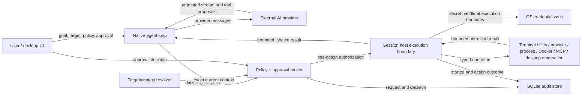

# Agent-to-tool threat model

- Status: Accepted for desktop-v1 implementation
- Date: 2026-07-25
- Scope: Asura desktop M3 agent target resolution, policy, approval,
  capability brokering, and audited tool execution
- Related decisions:
  [ADR 0017](../adr/0017-native-dotnet-agent-runtime.md),
  [ADR 0018](../adr/0018-native-ai-provider-and-chat-boundary.md),
  [ADR 0019](../adr/0019-one-action-agent-capability-broker.md),
  [ADR 0020](../adr/0020-native-webview-wrapper-and-first-browser-capability-slice.md),
  [ADR 0021](../adr/0021-governed-browser-state-and-navigation.md),
  [ADR 0022](../adr/0022-governed-browser-origin-containment.md),
  [ADR 0023](../adr/0023-governed-native-document-snapshots.md),
  [ADR 0024](../adr/0024-governed-browser-element-click.md),
  [ADR 0025](../adr/0025-governed-browser-element-fill.md),
  [ADR 0026](../adr/0026-native-browser-capability-conformance-gate.md),
  [ADR 0027](../adr/0027-governed-browser-element-check.md),
  [ADR 0028](../adr/0028-governed-file-viewer-observations.md),
  [ADR 0029](../adr/0029-scope-clipped-governed-workspace-graph-observations.md),
  [ADR 0030](../adr/0030-governed-file-viewer-mkdir-and-delete.md),
  [ADR 0031](../adr/0031-governed-terminal-character-chords.md),
  [ADR 0034](../adr/0034-governed-local-process-monitor-observation.md),
  [ADR 0035](../adr/0035-intrinsic-agent-user-clarification.md),
  [ADR 0036](../adr/0036-intrinsic-agent-capability-request.md),
  [ADR 0037](../adr/0037-bounded-native-provider-steering.md),
  [ADR 0038](../adr/0038-governed-native-dotnet-mcp-stdio.md), and
  [ADR 0047](../adr/0047-governed-local-git-tools.md)
- Amended: 2026-11-10 for the proposed desktop automation family,
  [ADR 0061](../adr/0061-governed-desktop-automation-through-agent-desktop-ffi.md).
  That record is not accepted. Revised the same day against the composed
  implementation, and again after the review fixes to the close binding,
  the pre-authority guard under `Off`, launch classification, already
  satisfied element actions, and invalidation after an unproven mutation
  failure: Section 6 states, for each desktop finding, whether it is closed
  in the code, with the test that covers it, or still open.

## 1. Security objective

Asura lets a provider-backed, native .NET agent inspect and operate local
or remote terminal sessions and an initial ten-tool native-browser
state/snapshot/click/fill/check/navigation slice, perform bounded File Viewer
list/stat/text-preview observations plus the exact mkdir/permanent-delete
contracts, and perform scope-clipped workspace-graph observations plus exact
panel inspection and focus through governed application services. It can also
perform one bounded observation through an already-hosted local Process
Monitor panel. Production
currently enables governed WebDAV mkdir; governed permanent delete remains
fail-closed until a provider can prove its stronger semantics.
The runtime can also pause one provider tool continuation for a bounded local
user clarification. That response is intent data, not authorization.
It may separately ask the authenticated local user to change one currently
disabled, actually advertised production-tool capability to run-local `Ask`.
That policy decision approves no action; every later operation still requires
its normal exact authorization.
The authenticated local user may also steer one actively streaming initial
provider generation. Steering replaces uncommitted task intent only; it cannot
answer a question, decide a capability request, approve an action, change
policy, retarget the run, or rewrite a committed turn.
The MCP boundary may launch an explicitly configured local stdio server or
connect to an explicitly configured Streamable HTTP endpoint, freeze its
enabled tool manifest, and dispatch one governed tool call. It does not install
an agent or MCP runtime on a remote terminal target.
The desktop automation boundary proposed by ADR 0061 may read another
application's accessibility tree and deliver one headless, element-scoped
action to it through a native library loaded into the desktop process. It
grants no authority over Asura itself, binds no external application as a run
target, and exposes no coordinate input, clipboard, or screenshot. The family
is implemented and composed into the application: the typed contracts, the
trusted catalog entries, the in-process engine, the SessionHost gate, the
runtime tool set, the Settings row, and the packaging and signing steps exist
and were read for this amendment. It has not been exercised against a real
application through the governed path, because the test host has no macOS
Accessibility grant; the SessionHost and runtime tests use a recording engine
or a fake host. No signed bundle containing the library has been produced.
Model output, terminal output, browser content, file content, MCP results, and
other applications' accessibility trees are untrusted data. None of them grant
authority.

The security objective is:

> A tool action executes only when an authenticated live run, an exact current
> target, an explicit capability policy, the operation's risk, and any required
> user approval all authorize that one action. The session host revalidates the
> authorization at execution time and records the outcome without disclosing
> secrets.

## 2. Confirmed desktop-v1 assumptions

- Asura is a single-user desktop application. It does not expose inbound
  agent IPC, a local HTTP control endpoint, ACP, A2A, or a headless control
  endpoint in desktop v1.
- Same-account processes are not implicitly trusted. In-process composition
  reduces lifecycle complexity but is not an authorization boundary.
- Provider traffic is outbound HTTPS to an exact configured origin. Explicit
  unauthenticated HTTP is allowed only for an exact loopback endpoint.
- Provider adapters do not receive application tool executors, terminal
  sessions, file providers, browser objects, process launchers, or the OS vault.
- `Auto` may authorize routine read/wait actions. Mutations require `Ask`
  unless a more specific policy explicitly permits them. Destructive and
  high-risk actions still require approval in `Auto`. All five browser
  navigation tools are trusted mutations, so the current broker escalates
  `BrowserNavigation=Auto` to exact `HumanApproval`. `browser.click`,
  `browser.fill`, and `browser.check` are mutations under the separate `BrowserInteraction`
  capability and receive the same broker escalation. Only browser state and
  document snapshot reads normally receive `AutoPolicy`. Independently, the
  session-host browser gate accepts `HumanApproval` or an explicitly confirmed
  run-local `YoloPolicy` for click/fill/check and defensively accepts an
  `AutoPolicy` source only for closed observed operations and explicit
  navigation. It does not impose a site-origin allowlist. The three read-only File Viewer observations use the
  separate `ReadFiles` capability and normally receive `AutoPolicy`.
  `files.mkdir` is a mutation and `files.delete` is destructive; both escalate
  `Auto`, and the host accepts only exact `HumanApproval` or an explicitly
  confirmed run-local `YoloPolicy`. The four read-only workspace-graph
  observations use `Search`; they still require one-action authorization and
  audit because topology and titles disclose information.
- Every MCP tool is the trusted generic `mcp.call` mutation under `McpTools`.
  `Off` opens no MCP transport. `Ask` and `Auto` both require an exact
  `HumanApproval`; an explicitly confirmed run-local `YoloPolicy` can execute
  the same frozen one-action call without a second approval.
  Discovery metadata and annotations cannot supply capability or risk. A
  broker-issued launch lease for the exact registered actor, run, and live
  policy generation is required before catalog, vault, or transport access.
- `terminal.send_chord` is destructive terminal input, not text. It accepts
  one lowercase ASCII letter and exactly one Control or Alt modifier. `Auto`
  escalates, and SessionHost accepts only exact `HumanApproval` or an
  explicitly confirmed run-local `YoloPolicy`.
- `YOLO` is explicit, confirmed, target-scoped, run-bounded, immediately
  revocable, and audited. It is never inferred from a missing UI. Full access
  overlays every capability in the live run, including workspace layout,
  terminal, browser, file, database, Docker, and MCP tools that the exact
  workspace context actually exposes. Workspace, internal `OpenTab`,
  selected-panel, and exact-panel targets remain bound by the broker to that
  immutable run target. Typed request unions, current session/revision checks,
  input barriers, secret boundaries, cancellation, and one-action audit remain
  mandatory. Model data and durable policy cannot create the overlay.
- Durable screen and workspace policies accept only `Off`, `Ask`, and `Auto`.
  Selecting a saved screen for agent use grants no authority. The desktop must
  first instantiate its exact current revision, present the resulting live tab
  for review, and receive a separate confirmation binding the live window,
  workspace, and tab IDs. Missing dependencies or revision drift fail before
  authorization, and changing the ordinary scope clears this authorization
  context rather than widening it.
  When runtime graph acceptance succeeds, the desktop captures a normalized,
  complete policy plus its source definition IDs and revisions. Later
  definition edits cannot retarget the accepted tab. Recovery schema three
  preserves that exact provenance and rejects missing, malformed, incomplete,
  forged override markers, or YOLO-bearing policy data. Schema one and two
  restore a source-free, explicitly marked fail-closed default instead of
  consulting current definitions; the marker survives schema-three
  reserialization and clears only when current definition provenance is
  accepted.
- Governed prompts carry that trusted runtime policy into broker registration;
  `AgentPolicy.Provider` is the exact AI-provider profile ID and
  `AgentPolicy.Model` is the exact model supplied to the pinned provider
  adapter. A caller with no explicit override preserves configured permissions
  while binding provider/model identity to the selected profile and its
  captured default model. A saved override whose exact enabled profile is
  unavailable fails before broker registration or provider invocation.
  Provider output, model text, and panel content cannot provide policy. A target
  spanning multiple runtime policies takes the least-permissive value for each
  capability. Provider/model disagreement or an empty/invalid member set fails
  closed.
- Exact terminal-panel schemas omit `panel_id`. Every broader Workspace schema
  and every internal `OpenTab` or selected-terminal schema requires one current
  eligible `panel_id`, even when only one terminal can perform the requested
  operation; the parser never infers that identity from cardinality.
- `processes.list` is an observation under the independent `ProcessControl`
  capability, whose product default is `Off`. When explicitly enabled it still
  receives one-action authorization and audit. It can target only a current
  active local Process Monitor session; it cannot run a command, select a
  terminal connection, or observe the remote machine behind that terminal.
  Exact schemas omit `panel_id`; Workspace and internal `OpenTab` schemas
  require one current host-enumerated Process Monitor `panel_id`, even when
  only one is eligible.
  Sort and limit are restricted to a closed enum and `16`/`32`/`64`.
- `agent.ask_user` is an intrinsic runtime continuation, not a cataloged
  application action. Its closed schema carries only one bounded,
  strict-Unicode, literal-secret-free question. A random run-local ID, exact
  UTC expiry, one-way response claim, and post-response pinned-target check
  bind one submitted/declined answer to one pending question. The answer is
  explicitly non-authoritative: it cannot approve an action, change policy,
  add a capability, choose a target, or bypass the broker. Questions and
  answers create no action-audit or SessionHost operation.
- `agent.request_capability` is a separate intrinsic policy request, not a
  cataloged application action or ordinary approval. It is dynamically
  advertised only for capabilities mapped by the trusted catalog from
  ordinary production tools which are actually in the final current tool set
  and `Off` in the run policy. Its closed schema selects one stable capability
  token and carries no prose, target, permission, duration, persistence, or UI
  instruction. A separate authenticated, expiring card may change exactly one
  run-local permission from `Off` to `Ask`; it never grants `Auto` or YOLO and
  approves no action. Allow commits the broker's deterministic policy-update
  audit before success. Denial and expiry make no policy change and create no
  action audit.
- `agent.steer` is a human-only application operation, not a provider tool,
  broker action, clarification response, capability decision, or action
  approval. It is available once only while the initial provider generation is
  streaming after exact target resolution. The request binds the current run
  ID, exact projected initial kernel generation, and one bounded user update;
  a delayed request from an earlier turn cannot steer a later turn in the same
  run. Before the kernel accepts it, the runtime
  re-inspects the pinned target identity and, for Workspace or internal
  `OpenTab`, the current live topology. It revalidates the run/session/
  cancellation owner, immutable provider revision/current status, and
  baseline/run/effective policy generation. Acceptance preserves the exact
  provider/tool manifest for that steerable generation and creates one revised
  uncommitted user message.
  It changes no authority and creates no action or policy audit.
- The current desktop exposes ordinary live-scope choices for the active panel,
  current tab, Workspace, and selected terminals. It also exposes the separate
  two-phase saved-screen workflow described above; the template itself is never
  an `AgentTarget`. The run
  pins the selected exact enclosing identity and refreshes its current ordered
  eligible Terminal, Browser, File Viewer, Statistics, and Process Monitor
  topology before the initial provider call and between tool-result rounds.
  Tool schemas and the context inspector are rebuilt from that trusted refresh;
  new eligible panels may appear and closed panels may disappear without
  retargeting the run. Provider output cannot choose a window, workspace, or
  unadvertised panel.
  Exact panel/session, `OpenTab`, and selected-terminal targets remain
  internal/testable contracts. Exact and selected targets pin complete
  membership and fail closed on drift; `OpenTab` pins its enclosing identity
  and refreshes eligible topology like Workspace. Every broad action still
  requires a current host-enumerated `panel_id`, is narrowed to one exact
  panel/session, and is freshly revalidated adjacent to one-action permit
  consumption and dispatch.
- All five first-family workspace-graph actions are production-reachable.
  `workspace.inspect` accepts only `{}` and resolves the one workspace fixed
  by the trusted run context; `tab.list` and
  `panel.list` accept only an optional fixed page offset and no identity,
  discovery query, filter, sort, total, or page size. They project registered
  graph objects already inside the original target, including non-session
  Statistics and Process Monitor panels, and expose no sibling totals.
  Graphless sessions advertise none of the four observation tools. Exact
  panel/session `panel.inspect` and `panel.focus` schemas accept only an empty
  object. Every broader panel-action schema requires exactly one `panel_id`
  enumerated from current active graph-backed members, even when only one
  member is eligible; unknown or out-of-scope fields fail closed.
- Workspace layout mutations exist only for the one complete Workspace target.
  Their schemas enumerate current graph-owned IDs and trusted supported panel
  kinds. The action digest binds ordered topology, one `WorkspaceLayout` permit
  authorizes one mutation, and the UI bridge never retries drift. Unsaved
  database edits reject close. After the UI commit boundary, an absent or
  unverifiable fresh graph becomes the non-retryable tool failure
  `workspace_layout_outcome_unknown`. The locally observable graph remains
  available for reconciliation; a newer graph is accepted only when it retains
  the exact applied target.
- Normal browser chrome operations require the exact interactive `Human`
  actor/client. An `Agent` actor cannot use that API; the governed browser
  bridge requires broker authority and the exact interactive attachment owned
  by the approving client.
- Browser control uses the existing CEF panel and its sandboxed Chromium
  subprocesses. No Node.js controller, remote-debugging port, ambient JavaScript
  bridge, or separately agent-owned browser is launched.
- Governed File Viewer control uses the existing hosted `IFilePanelSession`.
  The model supplies only bounded structured path segments relative to a
  session-owned root. Governed mkdir and delete additionally require a
  non-root path. The model cannot supply a provider ID, authority, root,
  absolute path, version, page controls, continuation token, read limit,
  mutation precondition, recursive flag, trash/undo behavior, or retry policy.
  The host derives mkdir `MustNotExist` and permanent delete
  `Recursive: false`/`MustExist`.
  Ordinary mutation support is not agent authority. The runtime, composer, and
  host also require a production-assigned governed capability. Current
  production enables WebDAV mkdir only and no governed delete. Local, SFTP,
  FTP, and SMB pathname mutation remains human-only because prior
  ancestor checks are not race-bound to the later operation. WebDAV delete is
  human-only because a file can become a collection between kind inspection
  and DELETE, whose collection semantics would violate non-recursive approval.
  S3 key-only delete is human-only because bucket versioning can change
  concurrently and turn the claimed permanent delete into a retained-version
  soft delete marker.
  A saved File Viewer waits unbound for its exact profile, permits no
  substitution or location editing, and first binds the exact saved structured
  location; a failed first ensure retries only that location.
  Only versionless hierarchical sessions advertise this first slice; ordinary
  object/container File Viewer sessions remain available to a human.
- Document snapshots, click, fill, and check use fixed application-private
  native-adapter scripts, not provider-supplied JavaScript or selectors.
  Capture and the exact element registry are bounded page-realm mechanisms for
  the top document, not a cross-platform native accessibility tree or isolated
  browser world. Fill is limited to `<textarea>` and input
  `text`/`search`/`email`/`url`/`tel`; password, file, and contenteditable are
  excluded. Check accepts only native checkbox/radio inputs and never exposes
  uncheck or general property-setting authority.
- Production advertises state, navigation, snapshots, semantic and low-level
  input, waits, and stop; arbitrary script evaluation remains disabled.
  Confirmed run-local Full access selects host-owned workspace-network
  authority, giving the agent the same private/public network access as manual
  browsing. It retains the existing renderer, profile, cookies, and workspace
  route, with no direct fallback around a proxy. This is not a public-only
  network policy. Other authorization sources still require peer-bound
  transport; the shipped CEF adapter cannot provide it and rejects those
  mutations before dispatch. Providers cannot select workspace-network
  authority in arguments. Native input observes run/lease cancellation and
  releases pressed keys/buttons. The macOS arm64 native acceptance runner
  covers cold hidden navigation, semantic input, cookies, cancellation, and
  authenticated proxy routing. Factory, session, and renderer share one fixed
  capability profile, and renderer attachment rejects capability drift.
- Desktop automation (ADR 0061, proposed) adds the closed `desktop.*` family
  under three capabilities that default to `Off` in initial permissions,
  durable workspace and screen definitions, recovery, and checkpoint history:
  `DesktopData` for `desktop.list_apps`, `desktop.list_windows`,
  `desktop.snapshot`, and `desktop.wait`; `DesktopInteraction` for the eight
  headless element mutations; and `DesktopControl` for the destructive
  `desktop.press_key`, `desktop.focus_window`, `desktop.launch_app`, and
  `desktop.close_app`. `Auto` authorizes `DesktopData` only, because the
  shared policy resolver authorizes observation and routine risk alone; every
  `DesktopInteraction` and `DesktopControl` action escalates to exact
  `HumanApproval`. The independent SessionHost desktop gate
  (`InMemorySessionHostClient.HasDesktopAuthorization`) accepts only
  `HumanApproval` or an explicitly confirmed run-local `YoloPolicy` for those
  actions and refuses an `AutoPolicy` permit for them
  (`AgentDesktopPolicyGateTests.HostRefusesAnAutoPermitForInput`). The trusted
  composer refuses any target other than the complete Workspace. The runtime
  advertises the family only when the library loaded and the operating system
  reports the Accessibility grant, and asks again before every desktop call,
  so a grant withdrawn mid-run refuses the next call before authority.
  Asura reads that grant and never requests it on the agent's behalf: the one
  permission entrypoint it binds reports and does not prompt.
- Another application is an untrusted content source. Its name, bundle
  identifier, window titles, and every role, name, value, description, and
  state in its accessibility tree are written by that application, or by
  remote content it displays, and are handled like browser page content.
- An external application cannot be bound as a run target. The run stays
  pinned to its Workspace; each desktop proposal names its own external
  process, snapshot, and element, and no approval, capability, or scope
  choice confines a run to one application. Selecting a narrower Asura scope
  does not narrow desktop authority, so narrower targets carry no desktop
  tool at all.
- The desktop family provides no human-override lease. Terminal input is
  revoked by the user's own keystrokes; a headless desktop action is not. The
  interaction lease that agent-desktop takes serializes agent-desktop
  consumers, not humans, so an approved action lands even while the user is
  typing in the same application.
- The automation library is third-party Rust loaded into the desktop process.
  There is no process boundary between it and the broker, the vault session,
  or the approval UI, and no fallback to a CLI or MCP child. Asura itself is
  never a desktop target: the self-operation guard refuses Asura's own
  processes before any approval card and without an override.
- Remote machines run no Asura agent. They receive ordinary terminal input
  through an already established connection and return terminal output.
- Future headless, ACP, A2A, remote browser control, and multi-user hosting must
  add authenticated caller identity and transport decisions without weakening
  this broker.

## 3. Assets

| Asset | Security property |
|---|---|
| Local and remote terminal control | Input is limited to the authorized live session and capability. |
| Local and provider-backed files | Reads and mutations stay within an explicit provider/profile and structured location prefix. |
| Connection and provider credentials | Application-managed and vault-resolved values remain in the OS vault and never enter prompts, transcripts, tool results, logs, or approvals. User-authored provider instructions are intentional prompt content and do not weaken this credential boundary. |
| Runtime workspace graph | A run cannot cross its immutable panel/session/`OpenTab`/Workspace/selection identity. Refreshing eligible topology inside the same Workspace or `OpenTab` is not target widening. |
| Browser profiles, authenticated pages, and snapshot references | Navigation, page data, one-shot exact-object handles, cookies, storage, downloads, and permissions remain separately governed. |
| Local process metadata | Observation is limited to one authorized hosted local Process Monitor, excludes command lines/paths/users/environment, and never implies remote-host process authority. |
| MCP server profiles, child processes, remote endpoints, transport secrets, and frozen tool manifests | Only trusted, enabled, revisioned stdio/Streamable-HTTP definitions, broker-authorized opens, and exact allowlisted run-frozen aliases can reach the generic governed call boundary. Imported profiles are forced disabled and untrusted; reviewed trusted profiles may be tested while disabled without becoming agent-selectable. Credential rotation closes every referencing session before returning. |
| Process mutation, Git, Docker, and network authority | Each family has an independent capability and risk rule. |
| Other applications' windows, controls, and displayed content | Observation and input reach one named external application through one exact snapshot reference. A read is bounded, redacted, and labeled untrusted; a mutation is one approved, headless, element-scoped action that is never repeated. |
| Asura's own authority surface: approval cards, Settings, policy controls, the composer, and every Asura process | Never observable or operable through the desktop family, whatever the policy or approval. |
| The operating-system Accessibility grant held by Asura | The grant belongs to the application bundle, not to a run or a capability. Only the closed desktop tool set may exercise it for the agent, and Asura never requests it on the agent's behalf. |
| The agent-desktop library and its colocated helper executable on disk | Only the copy built from the pinned commit, staged with its receipt, and signed with Asura's identity is loaded or launched. |
| The agent-desktop state directory `<profile data directory>/agent-desktop/` | Owned by the user with mode `0700`, private to Asura's runs, never shared with `~/.agent-desktop`, and removed per run. Its reference maps hold other applications' element names and values. |
| Approval decisions | Decisions are tied to an actor, run, proposal, exact material arguments, target revision, scope, and expiry. |
| Audit history | Requested, decided, started, and agent-action outcomes are durable, correlated, ordered, and secret-free. |
| Application availability | Provider streams, output, waits, and tool work are bounded and cancellable. |

## 4. Trust boundaries and data flow

The important boundary is between a model proposal and a session-host
operation. A proposal is inert data. Only the broker can issue a one-action
authorization, and only the session host can consume it.

Desktop automation adds four boundaries that the diagram's single runtime node
hides:

- The library boundary is a C ABI inside the desktop process, not a process
  boundary. `Asura.DesktopAutomation` is the only project that names an
  `ad_*` symbol, and it never sees authorization. A memory-safety fault or
  hard abort in the library is a fault in the process that holds the broker,
  the vault session, and the Accessibility grant.
- The boundary to another application is its accessibility tree. Everything
  that crosses it inbound is attacker-influenced data; everything that crosses
  it outbound is input that cannot be recalled.
- The helper executable `agent-desktop-macos-helper` (on Linux
  `agent-desktop-linux-clipboard-owner`) ships beside the library. In the
  pinned source the macOS helper is launched only from the clipboard module,
  which no entrypoint Asura binds reaches; this was read, not exercised. When
  it does run it is a child of the desktop process and runs as Asura.
- The state directory is a filesystem boundary shared with every process of
  the same account. The library reads its reference maps back from it before
  each action.

## 5. Entry points and attacker capabilities

### Entry points

- provider messages, streamed fragments, tool names, arguments, and usage data;
- terminal screen content, shell-integration metadata, escape-derived titles,
  and output from compromised remote hosts;
- browser DOM/accessibility text, URLs, downloads, dialogs, and page scripts;
- file names, metadata, previews, repository content, and structured documents;
- MCP server configuration, tool descriptions, arguments, and results;
- other applications' names, bundle identifiers, window titles, and
  accessibility roles, names, values, descriptions, and states, including
  remote content those applications display;
- the JSON envelopes, C structures, status codes, and delivery dispositions
  returned by the agent-desktop library;
- the desktop process environment at launch, in particular the library's own
  `AGENT_DESKTOP_MACOS_HELPER_PATH` and `AGENT_DESKTOP_INTERACTION_LEASE_FD`,
  which Asura removes before the library loads, and the application
  directory the library is loaded from;
- the agent-desktop state directory, its reference maps, and its session
  manifests;
- user-entered provider, connection, browser, file-provider, and policy
  configuration;
- durable definitions and runtime-recovery data loaded from SQLite;
- native terminal, embedded-browser, connection-library, and OS-vault adapter
  failures.

### Credible attackers

- a malicious or compromised AI provider;
- prompt injection embedded in terminal, browser, file, repository, or MCP
  content;
- a compromised remote SSH host or container;
- a malicious MCP server or file provider;
- a local application that shapes its accessibility tree, names itself after
  another application or after Asura, or starts at a chosen moment;
- a local same-user process that sets the desktop process's launch
  environment, replaces the automation library or helper, or writes the
  agent-desktop state directory;
- a local same-user process attempting to reuse durable state or credentials;
- an operator who enables a broad policy without understanding its effect;
- accidental races caused by tab/panel/session closure, reconnect, retargeting,
  cancellation, or approval expiry.

Desktop v1 does not attempt to survive a fully compromised operating-system
account or kernel. It still minimizes credential exposure and ambient authority
so a content-level compromise does not automatically become tool authority.

## 6. Threats and required controls

| ID | Threat / abuse path | Impact | Required control |
|---|---|---|---|
| T1 | Provider emits a plausible tool call and bypasses application authorization. | Critical | Provider adapters expose proposals only. They have no executor or session-host dependency. Broker authorization is mandatory. |
| T2 | Terminal/page/file/process/panel-label/MCP content instructs the model to expand scope or reveal secrets. | Critical | All external content is labeled untrusted. File results carry `content_origin=untrusted_file`; MCP results carry `content_origin=untrusted_mcp`; local process results carry `content_origin=untrusted_local_process_metadata`; panel inspection carries `content_origin=untrusted_panel_metadata`; workspace-graph observations carry `content_origin=untrusted_workspace_graph_metadata`. Provider names/content, MCP server/tool metadata, graph and panel titles, connection boundaries, working directories, and process display names are bounded and redacted before continuation. MCP annotation fields are removed from provider schemas and cannot supply trusted approval text. Graph/process labels with literal-secret shapes or unsafe Unicode are replaced and accepted labels are rune-safe truncated to 128 UTF-8 bytes. Content cannot modify target, policy, approvals, or tool schemas. Secrets use opaque handles only. |
| T3 | A target silently widens to another workspace/tab/connection, or a stale provider-selected panel is substituted after topology refresh. | High | The visible run pins one immutable window/workspace identity; provider data cannot name or change it. Workspace and internal `OpenTab` targets refresh current eligible topology only inside that enclosing identity at provider-round boundaries. Every resulting broad schema enumerates current eligible panel IDs, and each proposal is freshly parsed, narrowed, approved, and executed against one exact current panel/session binding. A panel that disappears or changes after proposal preparation fails closed rather than being substituted. Internal exact and selected-terminal targets retain their complete fixed membership and reject drift. No refresh crosses the pinned workspace/tab identity, and no action falls back to another member. |
| T4 | A target or interactive terminal/browser attachment, File Viewer session, or Process Monitor session changes after approval but before execution. | Critical | Broad tool schemas expose only capability-supporting current panel IDs and require `panel_id` for browser, File Viewer, Process Monitor, and governed panel actions even when only one member is eligible. Exact panel/session schemas omit `panel_id` and accept only their closed action-specific fields; exact `panel.inspect` and `panel.focus` accept only `{}`. The runtime parses the selected ID against a fresh live resolution, and the trusted composer narrows it to one exact panel/session. Graph observations separately bind the current ordered scope-relative `window/workspace/tab/panel/kind` sequence for that action. SessionHost reconstructs that clipped sequence under its graph gate around one-action consumption; add/remove/reorder/kind drift during the action or exact-session supersession fails before projection, while a completed Workspace/`OpenTab` change may become the next round's freshly resolved baseline. For `panel.focus`, SessionHost holds the graph gate across exact resolution, permit consumption, fresh binding comparison, adjacent cancellation check, and expected-revision graph activation. No focus occurs before the one-action permit; revision/session drift fails before commit; late cancellation cannot erase a committed receipt; already-focused activation preserves graph revision and sequence. Governed browser dispatch requires exactly one current interactive attachment owned by the authenticated approving desktop client. Terminal resize similarly requires one owned attachment, preserves its trusted logical dimensions/render scale, and binds its opaque identity plus every viewport field. File approvals and authorizations bind the exact session revision, provider profile, authority, immutable trusted root, relative segments, and host-owned operation bounds. Process observation binds exact local panel/session revision, capabilities, sort, and limit, then post-validates the binding before publishing the one captured sample. File-mutation requests additionally bind the trusted operation while SessionHost derives `MustNotExist` for mkdir or permanent `Recursive: false`/`MustExist` for delete; the model cannot supply those fields. Approval and authorization bind target IDs, session and attachment IDs where applicable, graph/session revision, operation, material-argument digest, run, actor, and expiry. Host revalidates ownership, scope, exact session revision, provider/session capability, lease or attachment authority before starting. SessionHost projects the browser's trusted canonical origin plus document revision into immutable session metadata and the context fingerprint. Click, fill, and check require the requested revision to match that projection; their approval and digest bind its canonical origin, and execution reconstructs the material from a fresh context so origin or revision drift fails before authorization consumption. A guarded browser mutation additionally binds the committed address/document revision used by domain policy and rechecks it on the renderer UI thread; later drift fails retryably with `browser_state_changed` before native dispatch. Snapshot capture binds the same exact logical address/revision, translates it to the exact last-projected renderer-local document, and rechecks both before publishing; renderer revision regression invalidates the projection and references and fails closed. Click and check approvals bind the complete opaque reference and provider document revision; fill binds both plus the exact bounded text. The host binds the current address, and the session translates the exact logical source document to its renderer-local projection and verifies the returned receipt. Browser and file agent actions cannot use their normal human paths. Renderer, human, and governed terminal resizes share a per-session engine-plus-metadata transaction; after a successful engine/browser/file-mutation return, unrelated revisions and late caller cancellation do not reverse a reported effect, while changed authority before dispatch still fails closed. Missing, ambiguous, replaced, or revoked attachments/sessions are never inferred or substituted. |
| T5 | A mutation is mislabeled as a read and runs under `Auto`. | Critical | Closed tool catalog assigns capability and risk in trusted code. Model/provider supplied risk labels are ignored. The four workspace-graph reads and `panel.inspect` are `Search` observations; `processes.list` is a separate `ProcessControl` observation whose default remains `Off`; `panel.focus` is a `RunCommands` routine action and therefore follows the run's command permission rather than inheriting inspection authority. `browser.click`, `browser.fill`, and `browser.check` are mutations under distinct `BrowserInteraction`, the broker escalates `Auto`, and the host accepts exact `HumanApproval` or confirmed run-local `YoloPolicy`. `files.list`, `files.stat`, and `files.read` are closed observations. `files.mkdir` is a create-directory mutation and `files.delete` is destructive; both escalate `Auto`, and the host independently accepts only exact `HumanApproval` or a confirmed run-local `YoloPolicy`. Every MCP alias maps to the trusted generic `mcp.call` mutation regardless of server annotations; `Auto` escalates to human approval, while confirmed run-local Full access uses `YoloPolicy`. No rename, write, upload, transfer, trash, recursive-delete, or root-delete request exists in the agent file union. Unknown tools fail closed. |
| T6 | An approval or element reference is replayed, reused for changed arguments, or consumed by another run/document. | Critical | Approval produces a random opaque, one-action authorization with exact bindings, short expiry, atomic single consumption, and durable correlation. Snapshot references are separately random, exact-document/adapter-bound, two-minute leases; an accepted click, fill, or check invalidates the complete snapshot reference set before native mutation, and next snapshot/navigation/revision/replacement/detach/close also revokes them. |
| T7 | `Off`, a denial, cancellation, or YOLO revocation races with tool start. | High | The broker owns effective policy and run state. Policy/run revocation cancels the old authority generation before waiting for broker audit I/O; pending, stale, or cancelled generations fail closed at consumption. A revocation racing a durable `started` event records `started -> cancelled` and never returns a usable permit. Cancellation reaches provider and tool work. Browser-interaction and governed-file-mutation cancellation is authoritative only before the native/provider mutation invocation commits; afterward a valid result or non-retryable outcome-unknown wins, so cancellation cannot falsely authorize a duplicate retry. |
| T8 | Agent terminal input conflicts with a human or continues invisibly. | High | Input arbiter grants an agent lease. The host links execution to the lease-authority token, and human lease preemption cancels blocked or in-flight agent input. Tools that inject terminal input require the explicit `terminal.agent_input_barrier` capability. Governed mouse input is a closed, bounded terminal-cell event whose button, kind, coordinates, modifiers, and exact session are bound to approval; the host independently rechecks both `terminal.mouse` and the barrier immediately before typed dispatch. Governed paste is available only with both `terminal.paste` and the barrier, never reads the ambient clipboard, and receives one one-action lease immediately before typed dispatch. `terminal.submit_text` additionally requires Enter support and combines paste encoding plus protocol-correct Enter into one queued PTY write, preventing human or agent input from interleaving between text and submission. Repeated special-key input is capped at 64 and encoded into one queued PTY write under the same lease, so clearing a bounded draft does not create an interleaving window. Rendered-screen search and revision-bound diffs are observation-only, byte/row bounded, and labeled untrusted; a stale diff baseline returns unavailable rather than reconstructed content. Generic interactive state and its optional input range are app-authored, expiring, untrusted observations, are clipped to the actual viewport, and never grant authority or claim approval semantics. The portable engine retains cancellation authority through the PTY write, skips cancelled queued work, normally waits for flush, and treats successful `WriteAsync` as the irreversible commit point: later cancellation or flush failure preserves the committed receipt while failing the session, rather than inviting a duplicate retry. Failure or shutdown drains every uncommitted acknowledgement. The managed path reacquires the exact human attachment lease adjacent to dispatch; the macOS native path synchronously gates every keyboard, modifier, IME, paste, and mouse event and advances an epoch that queued programmatic sends recheck on the AppKit main thread. Native smoke proves both current-epoch guarded paste and stale-epoch rejection after physical input. A renderer without that complete invariant receives no agent input tool. Terminal resize uses separate exact-attachment authority and serialization and grants no keyboard or mouse authority. Governed browser actions use their own exact browser attachment authority and never acquire or imply a terminal input lease. The UI shows the active operation and keeps stop/cancel available during waits and streaming. |
| T9 | Approval UI hides dangerous material arguments or host context. | High | Prompt shows actor, operation, exact target, applicable terminal host/working directory or complete bounded browser navigation URL, and—for click/fill/check—the trusted canonical current origin, exact opaque reference, and document revision. It uses a reversible quoted/escaped rendering of exact bounded fill or paste text, including whitespace and permitted controls. File presentation shows the exact provider profile/authority, trusted root and relative path, plus first-page/hidden policy, preview bound, mkdir `MustNotExist`, move's exact destination and `MustNotExist`, or permanent recursive/non-recursive delete `MustExist` semantics. Delete explicitly means whatever occupies that exact path at dispatch; it does not claim observed-object identity. The digest independently binds the raw exact material, including the interaction origin. Paste and file mutations can be confirmed only by exact human approval or an already-confirmed run-local YOLO policy; `AutoPolicy` fails again at the host. Prompts also show bounded redacted arguments, risk, duration, and once/session/persistent effect. Destructive actions are not summarized as routine. Page-authored role/name remains desirable context but never authority. |
| T10 | Secret values leak through prompts, command lines, environment, HTTP headers, results, audit, diagnostics, or errors. | Critical | Vault resolution happens only inside the execution adapter with exact scope/purpose. Audit stores reference/purpose only. Redaction and architecture tests reject secret-bearing shapes. Portable imports force AI-provider profiles disabled and replace every API-key or OAuth `SecretRef` before persistence, so a retargeted endpoint cannot inherit a stored profile-scoped credential. MCP profiles persist only environment/header names plus scoped `SecretRef` values. The direct child starts with environment inheritance cleared; remote HTTP receives only explicit non-reserved vault-backed headers. Transport secret values are bounded UTF-8, the host drops request/launch dictionaries after connection, keeps only clearable exact-secret redaction buffers for the run, and exposes count-only stderr metadata. MCP projections redact exact and likely literal secrets and omit process/endpoint/environment/header/profile/error identities. Panel inspection marks descriptive metadata untrusted, redacts secret-shaped title/connection/path fields, and never returns session status detail; focus returns only host IDs and commit receipt fields. Governed paste rejects likely literal-secret material before approval, never reads the OS clipboard, and exposes only a completion receipt rather than echoing text to the provider or audit. Browser state/snapshot output removes HTTP(S) query and fragment data, redacts secret-shaped page text, and maps failures through a closed stable-code allowlist instead of exposing renderer messages or arbitrary native/provider codes. Fill rejects literal secret-shaped text before approval; its provider result and durable audit never echo the text. Governed file paths reject literal-secret-shaped arguments, textual previews are strict UTF-8 and secret-shaped data is withheld or redacted, and closed file failure codes expose no provider message. File-mutation success returns only fixed `created`, `moved`/`destination_created`, or `deleted`/`permanent` booleans, plus the already trusted `panel_id` in broad scope. File content, names, versions, continuation tokens, raw paths, provider receipts, provider error messages, and raw MCP results are not persisted in audit. |
| T11 | Tool output exhausts memory, blocks indefinitely, or floods provider context. | High | Requests, snapshots, output bytes/tokens, event counts, waits, artifacts, and durations have explicit limits, truncation metadata, cancellation, and backpressure. MCP stdio adds pre-deserialization wire-message/JSON depth/node/duplicate-property bounds and bounded stderr draining; Streamable HTTP adds response-header, session-ID, and aggregate JSON/SSE response-byte bounds. Both enforce bounded tool pages/count/schema/argument/result/content items, one serialized call per run, and a final 64-KiB provider envelope. Each untrusted panel-inspection display field is limited to 128 UTF-8 bytes after redaction; focus emits a fixed receipt. Governed paste accepts exactly one non-empty Unicode value bounded to 2,048 UTF-8 bytes and permits only tab and line-break controls. Governed file paths are at most 64 segments/4 KiB, list is first-page-only at most 100 entries with hidden items disabled, and read is a strict-UTF-8 text/structured preview at most 64 KiB; serialization measures the escaped result envelope and reduces it to the kernel result limit. Remote protocols without server-side paging reject a directory snapshot after a fixed entry/name-byte ceiling and check cancellation while capturing it, before sorting and projecting a page. Native document capture accepts at most 128 nodes, permits only one outstanding capture per surface, and uses a bounded deadline; cancellation fences late completion and a timed-out capture keeps its original renderer and bounded pending gate until native completion is observed. Provider snapshot serialization measures the actual escaped JSON envelope and reduces its projection until it is at most 64 KiB. Click/fill/check and mouse/key/scroll exclude concurrent capture/navigation/interaction, share a 60-second native input deadline, and accept only closed one-field native results of at most 1 KiB; fill input is limited to 2,048 UTF-8 bytes and malformed output becomes outcome-unknown. |
| T12 | Audit omits a denied, failed, cancelled, or partially started action. | High | The broker durably records requested/decision/started states before granting authority. If an action-outcome append cannot be confirmed, it retains the exact immutable completion and deterministic audit event in bounded quarantine, suspends the run, and cancels current-generation authority. The host retries only that same completion and never redispatches the panel, terminal, browser, or file operation; changed retries fail closed. If the retry remains unresolved, provider continuation stops and the run is cancelled with a stable recovery error. SQLite enforces deterministic idempotent phase transitions, durable action claims prevent restart replay, and startup recovery reconciles orphaned `started` actions to secret-free `failed` with `application_restart_outcome_unknown`. Stable correlation IDs join run, proposal, authorization, and execution. |
| T13 | MCP adds a hidden local/remote execution path, inherits desktop credentials, redirects secrets, keeps a rotated credential, changes its catalog after discovery, or repeats an ambiguous side effect. | Critical | Schema-two durable profiles contain a closed `stdio` or `streamable-http` transport plus exact enabled tool names and no literal secret. Stdio carries one executable, ordered arguments, optional working directory, and environment-name-to-`SecretRef` bindings; HTTP carries one bounded absolute HTTP(S) endpoint, explicit plaintext acknowledgement, and non-reserved header-name-to-`SecretRef` bindings. Non-current schemas are rejected without conversion. Imported profiles are forced disabled. `McpTools=Off` opens no transport. The only exported `Asura.Mcp` production type is the governed session host; low-level clients, transport secrets, SDK DTO projection, and options are internal. Before catalog, vault, or transport access, that host requires a broker-issued lease for the exact registered actor/run and live enabled policy generation. The private stdio boundary uses no shell, clears ambient environment, bounds strict newline JSON, secret values/environment block, stderr, and root-process cleanup. The HTTP boundary forces Streamable HTTP, rejects redirects and cross-origin requests, disables ambient cookies/proxy/decompression, reserves protocol/framing headers, and bounds response headers, session IDs, and JSON/SSE body bytes. The SDK supplies initialization, POST message framing, JSON/SSE parsing, and session/protocol headers; the separate SSE transport is unsupported. Discovery intersects bounded pages with the exact allowlist and freezes profile revision, transport kind/target, negotiated protocol/server identity, secret-redacted display name, private per-session HMAC tool identity, sanitized object schema/digest, and provider-compatible run-local alias. Notifications only stale that manifest. Replacing or deleting an MCP-scoped credential synchronizes with any in-flight diagnostic probe and removes, cancels, and disposes every run that resolved it before returning. Every alias maps to trusted `mcp.call`; `Ask` and `Auto` require exact human approval; confirmed run-local Full access uses the same frozen one-action path without another prompt. The host re-inspects target/profile/manifest, consumes one authorization, and dispatches once. It never retries a tool call. Every post-dispatch cancellation, HTTP disconnect, transport failure, process exit, malformed/oversized result, or other invalid response is non-retryable `mcp_tool_outcome_unknown`; the uncertain MCP session closes, the result is committed, the stale batch remainder is skipped, and the provider can recover only from fresh observations. Valid text/structured results are bounded, redacted, and labeled `untrusted_mcp`; binary/resource content, stderr, raw exceptions, server-chosen diagnostic identifiers, and operational identities are omitted. Portable process APIs cannot prove containment of detached descendants; a configured executable is trusted code running with desktop-user authority, not a sandbox. A remote server has the authority of the deliberately delegated header credentials and can exfiltrate them. |
| T14 | Browser navigation or an element reference retargets after document/DOM change. | High | `BrowserData`, `BrowserInteraction`, and `BrowserNavigation` are separate capabilities. The broker escalates navigation mutations plus click/fill/check to exact `HumanApproval`; the host rechecks the authorization source, and click/fill/check accept `HumanApproval` or confirmed run-local `YoloPolicy`. Asura intentionally does not impose a same-origin browsing allowlist: authorized navigation, redirects, history movement, and activated links may cross sites. Guarded navigation and interaction still require `browser.navigation_origin_guard`, a ready/non-overlapping session, the exact logical starting address/revision translated to the renderer-local document, and an unrestricted navigation boundary. Interaction navigation waits for its terminal event; a nominal check success with no observed start waits through one queued UI-turn observation barrier. Snapshot uses only a fixed private script, accepts at most 128 top-document nodes, and returns random opaque leases bound to the exact document, adapter, snapshot nonce, element token, and mutation epoch. The fixed page-realm registry stores the exact `HTMLElement` object plus a validation closure, not a selector or sibling-index locator. Its `MutationObserver` watches top-document subtree/attribute/text changes; snapshot begin/finish and interaction dispatch flush pending records, and any epoch change clears the registry as stale. Click revalidates the exact object before synthetic activation. Fill restricts the exact object to supported text controls, rejects hidden/inert/disabled/read-only controls and deterministic normalization, and verifies the exact value before and after the synthetic `input` event. Check accepts only a native checkbox/radio and verifies checkedness after native activation. An accepted interaction clears all public/native leases before mutation. References also expire after two minutes, next snapshot, navigation/revision, adapter replacement, detach, or close. |
| T15 | A local process invokes future headless/ACP control without identity. | Critical | No desktop-v1 inbound endpoint. Future transports require authenticated caller identity, replay protection, approval routing, rate limits, and a separate ADR. |
| T16 | Audit records or durable approvals are edited to manufacture authority. | High | Audit is evidence, not an authorization source. Live broker state and one-action tokens are authoritative; persistent policy changes require authenticated UI confirmation and generation changes. |
| T17 | A committed browser click, fill, or check has an unknown outcome and the model retries an irreversible page action. | Critical | Cancellation is accepted only before native dispatch commits. After commit, malformed/oversized native output, timeout, exception, navigation ambiguity, receipt mismatch, or an unexpected in-process host exception becomes non-retryable `browser_interaction_outcome_unknown`; it is never normalized to cancellation and the interaction is never redispatched. A checkbox/radio that is definitely still unchecked returns the distinct retryable `browser_check_state_not_applied`. Observation/navigation host exceptions retain `browser_host_failed`. Check dispatch blocks page navigation for the operation, and ambiguous verification invalidates semantic references while preserving the current renderer and document rather than resetting it to `about:blank`. The runtime commits truly unknown results, skips every later proposal from the now-stale batch as `tool_batch_reconciliation_required`, and returns control to the provider for a fresh observation rather than destroying the conversation. |
| T18 | A hostile page poisons page-realm built-ins before or after snapshot capture and defeats exact-object or type checks. | Critical | Fixed scripts, closed parsers, and captured methods remain defense in depth but are not treated as an isolated world: `Map`/`Set`, `Function.prototype.call`, prototypes, and other realm-visible APIs may change before or after registry installation. Production therefore omits snapshot, click, fill, and check. The explicit full-automation candidate is limited to tests/conformance until a named adapter supplies hostile-page evidence. Factory, session, and surface share one immutable profile, renderer attachment requires exact capability equality, the host rejects a created session whose capabilities differ from the factory snapshot, and Desktop constructs its renderer from that same profile. |
| T19 | A file profile changes behind a live panel, a deferred saved panel binds a distractor root, or a malicious provider returns paths/tokens/content outside the requested scope. | Critical | The production File Viewer leases one complete provider-adapter generation for the session lifetime; list/stat/preview, ordinary and governed mutations, transfer enqueue, and retry use that generation, while active transfers retain an additional lease. Same-ID catalog replacement retires but cannot retarget that panel, and a new panel receives the new generation. A saved panel waits without host authority for its exact profile, refuses substitution, root fallback, or location editing, and binds its exact saved structured location on the first ensure; controls remain disabled during that commit and retry preserves the same location. The connection selector follows catalog materialization until a target is chosen; switching replaces the hosted panel session instead of retargeting its bound provider generation. Immutable metadata binds the exact initial root, capabilities, and limits into context and action fingerprints. SessionHost reconstructs requests from that metadata, then rejects excessive/hidden/malformed list entries, non-child or out-of-root paths, mismatched stat/preview locations, oversized/non-text/invalid-UTF-8 previews, and identity drift. Governed mkdir/delete/move additionally require non-root paths; move binds and resolves both source and destination inside the same immutable trusted root. The host derives mutation preconditions and validates exact in-root receipts, including mkdir final name and directory kind and move's exact destination. The panel boundary validates read-receipt source, offset, byte count, and bounded destination length before publishing a preview. Accepted locations are rebuilt from trusted request material; versions and continuation tokens are stripped, errors use a closed stable-code map, and runtime projection is bounded/redacted and labeled untrusted. |
| T20 | A provider, definition edit, recovery payload, or heterogeneous broad scope silently replaces the policy governing a live run. | Critical | A saved-screen template grants no agent authority: the desktop instantiates one exact current revision, requires review and separate confirmation of its exact live window/workspace/tab identity, and represents authority only as the resulting `OpenTab` target. Missing dependencies, pre-instantiation revision drift, stale live IDs, and unconfirmed pending instances fail closed; an ordinary scope change clears the saved-screen authorization context. Later definition edits cannot retarget an accepted live instance. Runtime graph acceptance captures immutable source IDs/revisions, an explicit-override marker, and a normalized durable policy before publication. The trusted desktop, not the provider request, supplies that policy to governed-run registration, and the run pins it until Clear. Provider is the exact profile ID and model is passed unchanged to the pinned adapter; an unavailable or mismatched explicit profile fails before broker/provider work. A no-override run binds configured permissions to the selected profile and captured default model, so presentation, broker, audit, and transport share one endpoint identity. Recovery schema three validates the complete capability set, provider/model, durable modes, override/fallback markers, and provenance before restoring; older schemas use a marked source-free default and reject newer fields under an older label. Broad scopes aggregate every explicitly governed member capability by least privilege, reject mixed explicit/inherited membership, and reject empty scopes or provider/model disagreement. Durable definitions and recovery never carry YOLO; only the separately confirmed live-run overlay can add it. |
| T21 | A graph observation leaks sibling topology, treats global ordinals as authority, or returns unbounded hostile titles. | High | Every graph projection is clipped to the immutable target identity before tool composition. Schemas accept no IDs or discovery query; fixed pages publish no totals. Each action's structural digest uses only its current ordered relative in-scope identity/kind sequence, so out-of-scope sibling insertion or reorder neither leaks through results nor creates a distinguishable failure. Drift during that action fails closed; Workspace and internal `OpenTab` may accept a completed in-scope topology change only through the next trusted round refresh, while exact/selected targets reject membership drift. Clipped results omit the global workspace revision and graph sequence clocks; only a complete Workspace target receives them. Graphless sessions advertise no graph tools. Results omit session and operational metadata, replace secret-shaped or unsafe-Unicode titles, truncate accepted titles to 128 UTF-8 bytes, carry an explicit untrusted origin, and enforce both application and serialized 64-KiB limits. |
| T22 | A file mutation happens, its response is lost or invalid, and the provider/model retries an irreversible effect. | Critical | SessionHost performs an adjacent final authority/cancellation check and invokes the captured mkdir/move/delete provider operation exactly once. A definite typed no-commit provider rejection is mapped to a closed failed tool result and returned to the model without redispatch. Once invocation begins, an ambiguous transport/cancellation failure, exception, or invalid/mismatched receipt becomes non-retryable `file_mutation_outcome_unknown`, is audited `Failed` rather than `Cancelled`, and is never redispatched. A valid exact receipt wins late cancellation, revocation, or drift. The runtime commits the ambiguous result, skips every later proposal in that stale batch, and requires fresh state inspection before a new provider-chosen action. Only the exact completion-audit event may use bounded reconciliation. S3/S3-compatible construction sets both `MaxErrorRetry` and `MaxStaleConnectionRetries` to zero and encodes the one-object mutation as one-key `DeleteObjectsAsync` POST with per-object `ETag` value `*` for `MustExist`, avoiding the response-less transparent replay observed with single-object DELETE. A bounded loopback proves one fully received POST for both a valid 503 and a zero-response-byte disconnect. WebDAV MKCOL and ordinary DELETE use explicit zero-length content; a second bounded loopback proves one fully received request after a zero-response-byte disconnect rather than the transport's otherwise observed replay. |
| T23 | An ordinary file provider capability is mistaken for race-free agent authority, truthful permanent deletion, rename authority, or recursive semantics. | Critical | Governed tools require separate production-assigned capabilities in addition to ordinary `CreateDirectory`/`Rename`/`Delete`, and the runtime, composer, and SessionHost each fail closed without them. Production grants local providers governed mkdir/move/delete and WebDAV only governed mkdir; remote rename/delete paths remain human-only where the adapter cannot prove the required mutation boundary. Local/SFTP/FTP/SMB ancestor checks are not bound to later pathname use. WebDAV kind inspection cannot prevent a file-to-collection replacement before recursive collection DELETE. S3 key-only delete can create a soft-delete marker and retain prior data if bucket versioning is enabled or suspended, and versioning can race a prior status check. Registration defaults to no governed capability; adapter-family, exact/broad schema, composer, and host-drift tests enforce the matrix without removing ordinary UI operations. |
| T24 | A character chord is smuggled as text/raw bytes, mislabeled as routine, or races physical terminal input. | Critical | `terminal.send_chord` accepts only one lowercase ASCII letter and exactly one Control or Alt modifier; bytes, escapes, text, key codes, modifier arrays, Shift, Meta, and combined modifiers are absent and rejected. The trusted catalog marks it `DestructiveTerminalActions`/`Destructive`; `Auto` escalates and SessionHost independently accepts only exact human approval or confirmed run-local YOLO. The composer binds the canonical chord and exact session. The host requires `terminal.send_chord` plus `terminal.agent_input_barrier`, consumes one permit, acquires one one-action lease, rechecks authority, and dispatches the typed port once. Portable input commits at the successful PTY write. The native shim exposes only an additive epoch-guarded ABI that validates the chord and rechecks physical-input epoch synchronously on the AppKit thread; stale authority sends nothing, and a committed receipt is never retried. |
| T25 | A local process observation is retargeted to a remote terminal, leaks secret-rich metadata, races panel closure, or floods provider/audit context. | High | `processes.list` exists only for an active graph-backed local Process Monitor session and uses `ProcessControl`/`Observation`; it never shells out or accepts a connection, command, session, or continuation token. It accepts only a bounded sort, limit, offset, optional exact PID, and optional bounded name filter. The exact composer binds panel/session/revision/capabilities and all filter/page material. SessionHost resolves and consumes one permit under the graph gate, invokes the captured typed monitor once outside the gate with caller/permit/session-close cancellation, then re-resolves and discards the sample on target drift. Hostile snapshots must satisfy UTC, count, PID uniqueness, finite CPU, memory, and row-limit invariants. Names use strict Unicode, secret/path/control redaction, and a 128-byte rune-safe bound. Provider JSON is measured at 64 KiB and omits command line, executable path, user, environment, open files, cumulative CPU time, and native errors. Audit stores only the stable result, duration, and returned count—not names, PIDs, measurements, source counts, or JSON—and completion reconciliation never recaptures. |
| T26 | A model uses a clarification to phish a secret, impersonate approval, bind a stale answer, flood the UI, or smuggle authority into a later action. | High | `agent.ask_user` is an intrinsic with a closed one-question schema and no capability, risk, broker, SessionHost, or action-audit path. Question and answer text use strict Unicode, single-line byte limits, and literal-secret rejection. The UI labels model text as untrusted and says that responses are neither approval nor a credential channel. A fresh opaque ID plus `now >= expiry` under the runtime gate atomically claims one response; stale, duplicate, late, cancelled, disposed, or stopped responses fail. The pinned target identity and applicable current topology are revalidated before presentation and after capture; exact/selected membership drift or enclosing-identity loss returns a fixed non-echoing failure. Only a matching successful structured result committed by `NativeAgentSession` can enter provider continuation or visible question/answer history. Questions are sequential, cannot overlap, expire independently, and remain subject to explicit decline or Stop; no call-count or whole-turn limit truncates legitimate workflows. Every later action still requires its own trusted catalog classification and broker authorization. |
| T27 | A model uses a capability request to self-escalate, grant multiple or unavailable tools, reuse an action approval, race target/policy drift, or retain authority across runs. | Critical | `agent.request_capability` is a native intrinsic outside `AgentToolCatalog`. A call to an advertised ordinary tool whose capability is such a candidate raises the same request on use (ADR 0036, amendment 1): the model supplies only the tool call, never the capability token, prose, or a decision, and the request returns null to the call only after the same human Allow, so the call then meets its ordinary `Ask` authorization; Keep Off, expiry, drift, or failure return the request's fixed code and no action reaches the broker. On-use requests are skipped under YOLO, for an external operator, after the turn's decision, while another request is pending, and for non-requestable capabilities, where the broker denies by policy as before (`GovernedAgentRuntimeDesktopTests.ACallWhoseCapabilityIsOffAsksToEnableItThenAsksForTheAction`, `KeepingACapabilityOffRefusesTheCallWithoutRunningTheTargetCheck`). Its dynamic closed one-token schema is derived only from the final actually advertised ordinary production tools and their trusted catalog mappings whose run-policy permission is currently `Off`; it is absent under YOLO. At most one accepted request reaches a human decision per top-level send. A separate random ID, `AwaitingCapabilityDecision` state, two-minute expiry, authenticated trusted-content card, and one-way claim cannot be substituted for a question or action approval. Pre- and post-decision checks bind the exact run, pinned target identity, applicable current topology and advertised tools, candidate, and policy generation. The broker persists a secret-free Requested event before presentation and exactly one closed terminal decision. Allow performs only run-local `Off`-to-`Ask`; the policy transition carries the same request ID and is durable before success. Audit ambiguity suspends or revokes run authority. The intrinsic returns no model prose, target, IDs, actor, or display text, never calls ordinary broker `RequestAsync`, receives no permit, and never invokes SessionHost. Denial/expiry create no action audit or policy transition, but close the separate capability-request audit chain. Stop, Clear, disposal, or a new run closes/discards the request and grant. Every subsequent action still requires its own trusted classification and exact authorization. |
| T28 | The agent observes or operates Asura itself or a process that holds Asura's authority: the approval card, Settings, the composer, a CEF helper, the workspace runtime, the sql-language worker, the connection backend, or another child process. | Critical | `AgentDesktopSelfTargetGuard` refuses, before any approval card and with no override, any request whose target process is Asura. The runtime asks for that pre-authority check only when the run's policy leaves the tool's capability on; under `Off` the broker denies the proposal by policy and no native code runs (D13, closed). A process is Asura when it is the desktop process; when its bundle identifier is `sh.asura` or a child of it; when its resolved executable lies inside the install root, which is the `.app` bundle when the executable sits in its `Contents/MacOS` and otherwise the executable's own directory, or inside the application base directory, both roots resolved the way the inspector reports paths and compared without case on macOS; or, on macOS only, when the desktop process is its direct parent. `AgentDesktopSelfTargetGuard.ForProcess` builds that configuration, and `AgentDesktopSelfTargetGuardTests` checks it with a fake inspector on the shipped layouts: CEF helpers under `Contents/Frameworks/Asura Helper*.app` whose parent is launchd are Asura, a helper outside the bundle whose parent is Asura is Asura on macOS only, and in the Linux `/opt/asura` layout an application Asura launched from elsewhere is foreign (`In_the_shipped_bundle_a_CEF_helper_outside_the_application_directory_is_Asura`, `A_helper_Asura_starts_from_outside_its_bundle_is_Asura_on_macOS_only`, `In_the_Linux_layout_the_install_directory_is_Asura_and_launched_children_are_not`). A process whose executable cannot be read is unverifiable and is answered as `desktop_app_not_found`, never treated as foreign. `desktop.list_apps` and unfiltered `desktop.list_windows` omit Asura-owned and unverifiable processes, including a process the listing reports with Asura's bundle identifier and a window whose owner is not listed and cannot be inspected (`AgentDesktopRunSession.ProjectApps` and `ProjectWindows`; `AgentDesktopListProjectionTests` on hand-written listings, because the library never lists the test host). An identifier equal to `Asura`, `Asura.app`, `sh.asura`, or a `sh.asura.` child is refused without consulting the process list, and an identifier that matches any running Asura process is refused even when it also matches a foreign one. The engine repeats the process check inside its one execution call, immediately before the native mutation. Nothing can be checked before a launch creates its process, so after a successful `ad_launch_app_exact` the engine takes a fresh running-application listing and classifies the launched process ID together with the bundle identifier that listing reports for it (`AgentDesktopRunSession.RefuseLaunchedProcess`), which recognizes an Asura copy outside the install root by its identifier. Asura is a `SelfTarget` failure with delivery `delivered_unverified`, which `AgentDesktopStableCodes.For` maps to its own code, `desktop_self_target_launched`: SessionHost audits it `failed` and never retries it. A process ID of 0 or a process whose executable cannot be read is `desktop_action_outcome_unknown`. A listing that cannot be read is also an unknown outcome, or the adapter fault itself, never the listing's own not-delivered refusal. A foreign process is the launch result (`AgentDesktopLaunchClassificationTests`, `AgentDesktopResultTests.ALaunchThatStartedAsuraIsReportedAsALaunchedSelfTargetAndReconciles`, `AgentDesktopSessionHostTests.ALaunchThatStartedAsuraIsAFailedSelfTargetThatIsNeverRetried`). The runtime receives only the stable code, so the launch case has a code distinct from the host guard's refusal: `desktop_self_target_launched` is a reconciliation code, so the batch remainder is skipped as `tool_batch_reconciliation_required` and a fresh snapshot is required, while a plain `desktop_self_target` after permit consumption proves nothing was delivered (`GovernedAgentRuntimeDesktopTests.ALaunchThatReachedAsuraSkipsTheBatchRemainderAndRequiresAFreshSnapshot`, `AHostSelfTargetRefusalOfALaunchProvesNothingWasDelivered`). Snapshots accept seven application-owned surfaces (`Toolbar` was removed because the pinned library does not offer it); the system surfaces are not representable in the request type. SessionHost audits a refusal before authority as `requested` then `denied` through `IAgentAuthorizationConsumer.RefuseAsync`, which claims the action so that no approval card can follow; it repeats the guard on the consumed permit immediately before its one engine call, and a self-target found there is audited `failed` with `desktop_self_target`, because the audit chain has no transition from `started` to `denied` (`AgentDesktopSessionHostTests.SelfTargetFoundAfterPermitConsumptionIsRefusedWithoutDispatch`, the `lifecycle.desktop-self-target-*` campaign cases, `AgentDesktopRefusalAuditTests`). Those host tests use a recording engine; the real guard is tested by `AgentDesktopSelfTargetGuardTests` with a fake inspector and by `AgentDesktopEngineNativeTests.A_target_that_is_this_process_is_refused_before_any_approval` against the real engine. Limits: the guard judges process identity and nothing else. It cannot see an Asura authority surface drawn by another process, such as an operating-system notification or dialog; a second Asura installation outside this install root that reports no `sh.asura` bundle identifier; or, on Linux, a helper started from outside the install root, because the parent rule and bundle identifiers exist only on macOS (D14). At dispatch the engine hands an element reference to the library only when the reference's snapshot was taken by the run's own adapter of the process, generation, and window the proposal names (D1, closed); the library still resolves the reference from its on-disk map, which a same-account process can rewrite (T35). It constrains only Asura's agent: other software can still operate Asura's window (T39). |
| T29 | Another application shapes its name, window title, or an element's role, name, value, or description to instruct the model, to misdescribe a control on the approval card, or to imitate another application. | Critical | Everything read from an accessibility tree is untrusted provider content. `AgentDesktopDisplayText` is its only carrier: strict Unicode, at most 128 UTF-8 bytes with rune-safe truncation, and whole-value replacement by `[REDACTED]` when the text is malformed, contains control, format, or line-separator characters, or looks like a literal secret. States are kept only when they are short lowercase ASCII words, at most sixteen per node. A reference is kept only when it is well formed and belongs to the snapshot that produced it. Window identifiers and process-generation tokens are bounded single-line tokens. Tree content can change no target, policy, approval, or tool schema: the run target is the Workspace, the tools are the closed catalog, and every mutation needs its own exact authorization. The runtime labels every desktop result `content_origin=untrusted_desktop`, bounds its serialized envelope to 64 KiB (`DesktopAgentToolResultJson`), and builds each element and window target from the host's own snapshot and listing results and the run's own clock, never from model arguments; a model-supplied ref or window identifier is only a lookup key, and only entries that reached the model in a result can be looked up (`DesktopAgentObservationLedger`, `DesktopAgentObservationLedgerTests`, `GovernedAgentRuntimeDesktopTests.AHostileSnapshotReachesTheProviderInsideTheResultBudget`, and, for entries trimmed from a hostile result, `OnlySnapshotNodesTheProviderWasShownBecomeTargets` and `OnlyListedWindowsTheProviderWasShownBecomeTargets`). Limits: bounding and redaction do not make content trustworthy. A browser, mail, or chat window carries remote attacker text into a snapshot without the browser family's address and query handling. The application name, window title, role, and element name on the approval card are the other application's claims; a button can be named `Cancel` and delete. An application chooses its own display name, so an impostor is told apart only by its process ID and by the ambiguity refusal in T30. |
| T30 | An approved action reaches a different window or process than the one approved: the process ID is reused, the application restarts, two applications share a name, a second instance is running, or a same-named process appears between the application listing and the snapshot. | Critical | agent-desktop resolves an application by name on every call and its ABI exposes no snapshot by process or window ID, so Asura resolves the model's identifier itself against the library's running-application list. `AgentDesktopApplicationResolver` requires exactly one running foreign match, then requires that the match's display name selects exactly one entry of the whole list by name or bundle identifier, unverifiable processes included; anything else is `desktop_ambiguous_target`, and a match that touches Asura is `desktop_self_target`. Asura passes that exact display name to the library and rejects a snapshot whose envelope names a different application. After the walk the engine requires that the name still selects exactly the resolved process, that the envelope's window is one of that process's windows in `ad_list_windows_exact`, and that its generation token is unchanged; otherwise the snapshot is refused as `desktop_ambiguous_target` and nothing of it is returned (`AgentDesktopRunSession.AttributeWalk`, D2, closed). Every element proposal binds the snapshot-qualified reference, the application display text and identity (the listed bundle identifier, else the resolved executable path), the process ID, agent-desktop's process-generation token, the window identifier and title, the role, the element name, and the secure flag into its digest; `desktop.focus_window` binds the application text and identity, window identifier, title, process ID, and token. `desktop.close_app` binds the application text and identity, process ID, and the generation token when a window of that process carried one, all taken from the run's own `desktop.list_apps`, `desktop.list_windows`, or snapshot results; its `app` argument is only a lookup key into them, and a name the run has not observed is `desktop_stale_ref` before authority (`DesktopAgentObservationLedger.ResolveClose`). The approval card shows `bundle_id` or `executable`, the process ID for focus and close, the window where there is one, and `snapshot_age`, `listing_age`, or `observation_age` (D7, closed for these eleven tools). The engine dispatches an element action only for a reference of a snapshot its adapter took of the same process, generation, and window, while a live window of that process still carries the token (D1, closed). The library re-identifies the reference against the process and generation it recorded and answers `STALE_REF` or `AMBIGUOUS_TARGET` rather than guessing. `desktop.focus_window` dispatches only the live window entry whose identifier, process ID, and generation token all equal the proposal's. `desktop.list_windows` for a named application keeps only windows of the resolved process. A reused process ID that now belongs to Asura or to an unreadable process fails the dispatch-time guard. Limits: the application identity is the application's own declaration or a file path, not a verified code signature; it tells applications apart and proves no publisher. A process without a listed window has no readable generation token and is bound by process ID alone. For a surface with no window, such as the menu bar of an application without windows, a same-named process that starts, is walked, and exits again before the second name check is credited to the resolved process; its references then resolve to an exited process and answer stale, so nothing is delivered, but the returned tree content is the other process's. The resolver works on a listing taken before the native call, and the library looks the name up again inside it: when the resolved application quits in between, the snapshot is refused by the checks above, and `desktop.launch_app`, which addresses a running application by its proven name, starts whatever that name resolves to then, classified only after the fact. ABI 7 has no wait or close by process, and `ad_window_op_exact` only moves, resizes, minimizes, maximizes, or restores a window, so `desktop.wait` and `desktop.close_app` hand the library a name: a window-title wait must match a window of the resolved process and a satisfied wait requires the name to still select that process (`AgentDesktopWaitAttributionTests`). Before a close the engine requires that the live process with the bound ID still has the bound identity, that its listed display name selects exactly that process under the resolver's rules, and that its first live window still carries the bound generation token; a process that is gone, changed identity, or has another token is `desktop_stale_ref` with nothing delivered (`AgentDesktopRunSession.ResolveObservedApplication`; `AgentDesktopApplicationResolverTests.An_observed_process_resolves_while_its_live_entry_keeps_the_observed_identity` and `An_observed_process_whose_name_reaches_Asura_or_another_process_is_refused`; against the release library without the grant, `AgentDesktopNativeCallTests.The_refusals_come_before_the_library_is_asked_to_act`). A close is reported as outcome-unknown when any other process answers to the name afterwards (`AgentDesktopApplicationResolverTests.After_a_close_by_name_only_the_closed_process_or_nothing_may_answer_to_that_name`). A replacement that matched or was closed and has exited again before that check leaves no trace. `desktop.launch_app` binds only the identifier the model supplied and its timeout: an application that is not running has no observed identity or process ID to bind (D7, open for it). The close binding is tested by `AgentDesktopActionComposerTests.AClosedApplicationIsBoundAndShownByItsObservedProcessAndIdentity`, the close cases of `DesktopAgentObservationLedgerTests`, and `GovernedAgentRuntimeDesktopTests.ClosingBindsTheListedProcessAndShowsItOnTheCard` and `ATargetTheRunNeverObservedIsRefusedBeforeAuthority`. Snapshots target an application by name with no window identifier, and the library answered `AMBIGUOUS_TARGET` for an application with many windows (reported during implementation, not reproduced for this amendment). |
| T31 | A password or other secret is read from another application or typed into one: a secure field's value, a secret shown in an ordinary control, text the model supplies, or the element state returned after an action. | Critical | A node is secure when agent-desktop reports the `secure` state or when its role, subrole, or role description contains `secure` or `password`. The projection never reads a secure node's value, places `secure` first so the state cap cannot drop it, and the result type rejects a secure node that carries a value. The state returned after an action withholds its value when the target was secure or has become secure. The pinned library itself withholds the value of a macOS secure text field (read from source). `desktop.set_value`, `desktop.type_text`, `desktop.clear`, and `desktop.press_key` cannot be constructed for a secure target, the runtime refuses them before authority, and the engine refuses them again immediately before dispatch with `desktop_secure_field`; the secure flag is part of the digest (D10, closed). The pinned library has no element-level "protected" state, so `secure` is the only one modelled. Input text is strict Unicode, at most 2,048 UTF-8 bytes, permits only tab and line-break controls, and is rejected when it looks like a literal secret; `desktop.select` option names use the same type. Every other displayed value passes the secret-shape redaction of T29. The user types credentials. Limits: secure detection is the observed application's own declaration. A custom-drawn field, a revealed password, a one-time code, a recovery phrase, another terminal's contents, or a token in an address bar is ordinary text and is disclosed unless it happens to be secret-shaped. Redaction is a heuristic over single values of at most 128 bytes. `desktop.click`, `desktop.select`, `desktop.toggle`, `desktop.expand`, and `desktop.scroll` still accept a secure element by decision, because none of them enters text into it. Snapshot content, including non-secure values, enters the provider conversation and its persisted checkpoint like any other tool result, and agent-desktop stores each referenced element's role, name, value, and description in plaintext under the state directory (T35). |
| T32 | A reference is acted on after the interface changed, or a committed desktop action has an unknown outcome and the model or the host repeats an irreversible effect in another application. | Critical | The engine makes at most one mutating `ad_*` call per request and never repeats it. It raises a dispatched flag immediately before that call; from then on only an explicit `not_delivered` disposition yields a retryable closed code. A dispatched call that returns any other disposition, an envelope that is absent, oversized, malformed, or contradicts its status code, a validation failure while reading the answer, or `AD_RESULT_ERR_INTERNAL` becomes `desktop_action_outcome_unknown` or `desktop_adapter_faulted` with a delivery value other than `not_delivered`. A mutation that reached the worker is awaited to its real outcome even when the caller cancels; an observation may be abandoned. The engine reads cancellation, which is also how a revocation arrives, again in `BeginMutation` immediately before every mutating call, and `AgentDesktopRunSession.Contain` turns any exception into a closed failure with nothing delivered before that call and into an unknown outcome after it, so nothing thrown leaves `ExecuteAsync` (D15, closed; `AgentDesktopRequestContainmentNativeTests`). Element actions are requested with the headless policy and the fixed 5,000 ms auto-wait budget, which a request can neither widen nor narrow. References are snapshot-qualified; a bare `@eN` is not representable, and a snapshot identifier has 3 to 64 characters. An element or snapshot the library no longer knows maps to `desktop_stale_ref`, and an upstream error code Asura does not know maps to `desktop_action_failed`. `AgentDesktopStableCodes.RequiresReconciliation` names the two outcomes after which the batch is stale. SessionHost consumes one permit per action, repeats the guard and reads cancellation adjacent to the one engine call, never retries, accepts an element action only with delivered input, verified or not, or with nothing delivered, which is how the pinned library answers an element already in the requested state, turns uncertain or unknown delivery into `desktop_action_outcome_unknown`, records an exception escaping the engine for a mutation as `desktop_action_outcome_unknown` and ends the run's desktop session, and audits both `failed`. `desktop.focus_window` and `desktop.close_app` succeed with "requested" semantics and are audited `desktop_requested`; an already-satisfied element action succeeds, is audited `desktop_already_satisfied`, and reaches the model as `desktop_action_completed` with `delivery` `not_delivered`, `verified` false, and `already_in_state` true (D11, closed by decision). The runtime classifies both reconciliation codes in `AgentToolOutcomePolicy.Classify`, skips the batch remainder as `tool_batch_reconciliation_required`, stops `agent.run_sequence` at the uncertain step, and refuses every desktop mutation except `desktop.launch_app` with `desktop_stale_ref` until a snapshot succeeds; that requirement survives Stop and Clear (`DesktopAgentObservationLedgerTests.EndingTheRunDoesNotLiftTheSnapshotRequirementOfAnUnknownOutcome` and `GovernedAgentRuntimeDesktopTests.AnExternalUnknownOutcomeEndsTheRunAndStillRequiresAFreshSnapshot`, which list applications and windows again after Clear and still see the close and the focus refused). Any other failure of a mutation that reached the host raises the same requirement and is not retryable unless its stable code proves that nothing was delivered: the closed not-delivered codes, `desktop_self_target` for anything but a launch, and the authorization refusals `target_changed`, `deadline_exceeded`, `approval_expired`, and `authorization_expired` (`GovernedAgentRuntime.FailDesktopActionAsync` and `ProvesNothingWasDelivered`). A completion the audit trail could not record, `completion_audit_unavailable`, therefore discards the run's observations as well as entering the general quarantine of T12 (`GovernedAgentRuntimeDesktopTests.AMutationWhoseCompletionAuditFailedStillRequiresAFreshSnapshot`); these codes are not reconciliation codes, so they do not mark the batch remainder `tool_batch_reconciliation_required`. References expire after two minutes in the run's ledger, on Clear or Stop, when the same window is snapshotted again, and after a mutation of the same window succeeds by delivering input; an already-satisfied element action leaves them usable (`DesktopAgentObservationLedgerTests.AnElementActionThatDeliveredNothingLeavesItsWindowObserved`, `GovernedAgentRuntimeDesktopTests.AnElementActionThatWasAlreadySatisfiedNeitherSkipsTheBatchNorExpiresItsWindow`). Only snapshot nodes and listed windows the provider was shown become targets (`GovernedAgentRuntimeDesktopTests.OnlySnapshotNodesTheProviderWasShownBecomeTargets` and `OnlyListedWindowsTheProviderWasShownBecomeTargets`). These host and runtime controls are tested with a recording engine and a fake host (`AgentDesktopSessionHostTests`, `GovernedAgentRuntimeDesktopTests`), not with the native engine. Limits: which element actions the library verifies in headless mode on real applications has not been measured; every one it cannot verify settles as outcome-unknown. `desktop.press_key` is not strictly headless: the pinned library raises a key press to its focus-fallback minimum (`Action::base_interaction_policy`, read from source), which may bring the target window forward but never moves the cursor. The library keeps up to 128 snapshots per run and does not itself apply the two-minute expiry. Asura cannot roll back what another application did with delivered input. |
| T33 | The native library panics, hits an internal fault, or corrupts memory inside the desktop process. | High | The library is built only with the pinned `release-ffi` profile, which keeps `panic = "unwind"` so the Rust side traps a panic at the boundary and answers `AD_RESULT_ERR_INTERNAL`. On that status from any call, including the permission probe, and from a failed adapter creation, whose cause the engine reads with `ad_last_error_code` on the same worker thread (`AgentDesktopRunSession.EnsureUsableAdapter`; `AgentDesktopAdapterCreationNativeTests`, which provoke a real internal error by obstructing the session's lock file), the run's session destroys its adapter, refuses every later request with `desktop_adapter_faulted`, and reports delivery as unknown when the mutation had been dispatched. The library handle is never freed after acceptance, so a faulted image is not unloaded under its own threads. The build fails when the shipped flavor exports `ad_test_panic_boundary` or the panic flavor lacks it. Every envelope is parsed defensively with a depth limit, and the three structures Asura passes by pointer are checked against the library's own size getters at load; the two it only reads back are pinned against the header by a test. SessionHost ends the faulted run's desktop session and the runtime cancels the run; the fault latch is per run by decision (ADR 0061, amendment 1), so another run, or the same run identifier after release, gets a fresh adapter from the same image (D6, closed by amendment; `AgentDesktopPanicIsolationEvidenceTests` with the panic flavor). A fault on the access probe withholds the family until restart, because the probe session stays faulted. Limits: there is no process boundary. A hard abort, a stack overflow, a memory-safety fault in the library's unsafe code or Objective-C bridges, a panic while unwinding, or a deadlock takes the desktop process, or the run's worker thread, with it; the profile is the only defence and the upstream default `release` profile must never be used. The pinned library reports every non-permission I/O error and every JSON error as `INTERNAL` (`AppError::code` in `crates/core/src/response/app_error.rs`, read from source), so a full disk, an unreadable or corrupt reference map, or a file planted under the state root faults and cancels a run, not only a panic; a session directory that is open to the group or to other users was seen to fail adapter creation the same way while those tests were written. |
| T34 | The automation library or its helper is replaced on disk or redirected through the environment, and foreign code runs inside the desktop process or under Asura's identity. | Critical | The loader loads exactly one file, `libagent_desktop_ffi` in the application base directory (`AgentDesktopLibrary.TryLoad` and `BundledPath`), with its helper beside it; no environment variable and no `runtimes/<rid>/native` folder can name another (D3, closed). A candidate is accepted only when all 26 required exports in `native/agent-desktop/required-exports.txt` resolve, the library's size getters for `AdAction`, `AdExactWindowInfo`, and `AdWaitArgs` equal Asura's mirrors, `ad_abi_version()` reports major 7, and `ad_init(7)` succeeds. A rejected candidate is unloaded, the family stays unavailable, and nothing falls back to a CLI or MCP child. Before the library loads, the engine removes the pinned library's own `AGENT_DESKTOP_MACOS_HELPER_PATH` and `AGENT_DESKTOP_INTERACTION_LEASE_FD` from the native environment with libc `unsetenv`, and leaves the family unavailable if either removal fails (D4, closed). `scripts/build-agent-desktop.sh` builds from one pinned commit with `--locked`, the pinned Rust toolchain, and the `release-ffi` profile, refuses a dirty or moved checkout, checks the export manifest, stages the license, a generated third-party notice, and the Rust standard library notice, and writes a receipt with the SHA-256, size, and mode of every staged file and, for the macOS library and helper, the `signatureRemovedSha256` that the post-signing check compares. `src/Asura.Desktop/Asura.Desktop.csproj` copies the library and helper from the staged directory of its effective runtime identifier (`AsuraEffectiveRuntimeIdentifier`), and copies nothing when either file is missing there. `scripts/sign-notarize-macos.sh` lists the library and the helper as required nested code in `Contents/MacOS`, signs them with the hardened runtime and a timestamp, and checks after signing that each carries the signing team, the hardened runtime, and no entitlements; `scripts/package-macos.sh` and `scripts/package-linux.sh` verify the staged build, copy both files byte for byte, refuse any evidence flavor in the output, and ship the legal files, catalog, and receipt; `AgentDesktopPackageProvenance.ValidateAfterCodeSigning` compares signature-removed hashes of the signed files against the receipt. The handshake proves compatibility, not authenticity: a candidate's initializers run inside the desktop process when it is loaded, before any check. On a Developer ID build the remaining control is hardened-runtime library validation, which Asura's entitlements do not disable, so the loader should refuse a library not signed by Apple or by Asura's team; a same-team library that passes the handshake, including an older shipped agent-desktop with ABI major 7, would still load. This was read from the entitlements and not exercised on a signed bundle. The pinned library validates its helper by filesystem identity and link count, not by signature. Open (D5): no signed or notarized bundle containing the library has been produced, so the signing checks and `ValidateAfterCodeSigning` have not run on one; the staged receipts still record the 25-entry export manifest that preceded `ad_last_error_code`, so `--verify-staged` rejects them until the flavors are staged again; and `licenses/native-desktop-automation-components.json` is `BLOCKED` pending review as a record, like the native terminal catalog, which nothing enforces and which does not gate a release. Replacement of the bundled files is otherwise bounded only by the bundle signature on macOS and by root ownership of the install directory for the Linux packages; a tarball installation is writable by the user. |
| T35 | The agent-desktop state directory is read, tampered with, or shared: reference maps are consumed or forged by another agent-desktop consumer or another same-account process, or the directory is replaced or left with wide permissions. | Critical | The engine creates or takes over `<profile data directory>/agent-desktop/`, refuses it and its `sessions` directory when either is a symbolic link (a dangling one included), sets the root's mode to `0700` and reads it back, sets `AGENT_DESKTOP_HOME` through libc `setenv` before the library loads, and leaves the family unavailable when any of this fails (`AgentDesktopAutomationEngine.PrepareStateRoot`, `AgentDesktopStateRootTests`). Reference maps therefore never go to `~/.agent-desktop`, so a separately installed CLI does not by default read references minted for an Asura run and Asura does not act on references minted elsewhere. Each adapter uses its own session directory under a fresh random name (`asura-` and 32 hexadecimal digits), never the run identifier, so a run used again after release never shares references with its predecessor; the adapter is destroyed and its directory deleted on release, disposal waits up to two seconds in total for workers to do so, and session directories older than 24 hours are removed at the next start, skipping symbolic links (`AgentDesktopRunLifecycleNativeTests`). The pinned library refuses a state root that is relative, a symlink, not a directory, or owned by another user, and writes its private files with mode `0600` (read from source). Limits: these controls stop other accounts and accidents, not a process of the same account. Reference maps are unauthenticated JSON that the library reads back before every action, and each entry carries the process ID, generation token, role, name, value, and description of an element. A same-account process, which includes a command the agent itself runs in a local terminal, can read other applications' element names and values from them and can rewrite an entry so that an approved reference resolves to a different element or process. Asura dispatches only references whose snapshot it recorded in memory for the same process, generation, and window (D1), but it cannot see an entry rewritten on disk after the snapshot: the library then acts on whatever element or process the entry names, an Asura process included, and ABI 7 never reports which process it acted on. Reading the map before dispatch was rejected: the check would race the rewrite and tie Asura to the library's file format. Still open (D9): the owner check is the library's alone; the maps of a worker still inside a native call when the disposal wait ends, or of a process that exited without releasing its runs, stay until a sweep a day later; a session manifest written into a session directory after it is created can turn on the library's trace capture; and whether `AGENT_DESKTOP_HOME`, set in the native environment, reaches local shells and other children of the desktop process was not verified. A second Asura instance on the same profile shares the state root: its sweep leaves younger sessions alone, but it deletes a session directory whose last write is more than 24 hours old even if the other instance's run is still alive. |
| T36 | Content from another application, typed text, or an application's identity leaks into the durable audit trail, a host error, or diagnostics. | High | A desktop action uses the ordinary closed agent-action audit shape: run, capability, trusted risk, permission, decision, authorization source, argument digest, closed error code, stable result code, and the bounded binding fields. That shape has no free-text member and rejects a result code outside lowercase letters, digits, `_`, and `-`. The desktop result code comes only from `AgentDesktopStableCodes`. The engine writes no audit and returns no native message: a failure is a closed code plus a delivery value. Tree content, element names, window titles, typed text, and application names reach the audit trail only inside the argument digest, which covers the reference, application text and identity, process ID, generation token, window identifier and title, role text, element name, secure flag, and action material together with the action identifier. SessionHost places fixed host text in every error and records refusals and outcomes only through the ordinary chain. A canary planted in every text field of the element and window targets, the engine results, and an engine exception message reaches neither the audit trail nor any host error (`AgentDesktopPolicyGateTests.AuditTrailNeverCarriesUntrustedDesktopText`), and a refusal trail is read back through the SQLite store by `AgentDesktopRefusalAuditReaderTests`. Limits: this covers the audit trail only. The approval presentation holds the application name, window title, element name, and exact text while it is displayed; snapshot results enter the provider conversation and its persisted checkpoint; the state directory holds names and values (T35); the engine's unavailable reason can embed a filesystem error message. The digest of a short action, such as one key, can be guessed by anyone who holds the audit record. |
| T37 | A model reaches desktop authority it was not given: it asks for `DesktopControl` through `agent.request_capability`, treats a capability grant as approval, or uses desktop tools to exercise authority that another family governs. | Critical | `agent.request_capability`, and a call to one of their tools while `Off`, may offer `DesktopData` and `DesktopInteraction` under its ordinary run-local `Off`-to-`Ask` rule and must never offer `DesktopControl`, which the user enables in policy; a control call under `Off` is denied by policy without a card (`ControlThePolicyTurnsOffNeverRunsTheTargetCheckAndIsDeniedByPolicy`). A grant approves no action, never yields `Auto` or YOLO, and ends with the run; every later desktop mutation still needs its own exact approval. The three capabilities are independent of every other family and default `Off` everywhere, including upgraded durable, recovered, and checkpointed policies. The catalog fixes capability and risk for all sixteen tools in trusted code, and the request types form a closed union with no way to express a new tool, a system surface, a coordinate, a held key, a multi-modifier chord, Command-Q, a path-shaped application identifier, or a force-quit. `GovernedAgentRuntime.IsRequestableCapability` excludes `DesktopControl` from the candidates, and a request for it never reaches the user (D8, closed; `GovernedAgentRuntimeDesktopTests.CapabilityRequestOffersDataAndInteractionButNeverControl`). The policy editors offer `Off`, `Ask`, and `Auto` for `DesktopData` and only `Off` and `Ask` for `DesktopInteraction` and `DesktopControl`, where `Auto` would authorize nothing beyond `Ask`, and open a stored `Auto` for either as `Ask` (`AgentPolicyPresentation.OffersAuto`; `AgentDesktopPolicyPresentationTests`, `AgentDesktopAccessSettingsHeadlessTests.The_AI_page_disables_Auto_for_desktop_app_interaction_and_control`). The broker still escalates an `Auto` that reaches it for those capabilities, and the host still refuses an `AutoPolicy` permit for them. Limits: the desktop capabilities reach what other capabilities govern. `DesktopInteraction` typing into another terminal emulator is command execution outside `RunCommands`; a snapshot of another browser is page reading outside `BrowserData`; a click in System Settings, a password manager, or another agent's approval dialog exercises authority that no Asura capability names. Exact per-action approval and the untrusted label are the only controls on what is done inside the other application. Under confirmed run-local YOLO there is no per-action approval, so the desktop family extends Full access from the confirmed Workspace to every other application on the desktop except Asura. |
| T38 | A huge, deep, or hostile accessibility tree, an unresponsive application, or a contended interaction lease exhausts memory, blocks a run, or floods provider context. | High | Each run has one worker thread and a single-consumer queue, so one native call runs at a time per run, and the access probe has its own adapter. The engine copies at most 8 MiB of envelope out of native memory, parses it with a JSON depth limit of 128, walks it with its own stack instead of recursion, and stops at 512 nodes and depth 32 whatever the library returned. It reads at most 64 states per node and keeps sixteen, bounds every display text to 128 bytes, treats a native list above 4,096 entries as malformed, reads list fields up to 1,024 bytes, and returns at most 128 applications or windows with a truncation flag. `desktop.wait` is limited to 30 seconds, `desktop.launch_app` to 15, and element actions to the fixed 5; snapshot depth is 1 to 32. The runtime offers `interactive_only` and `compact` and reduces the serialized provider envelope to at most 64 KiB. Limits: Asura passes a depth to the library and no node or byte limit, so the library's own walk and JSON construction in native memory are bounded only by its internal observation budget and deadlines, 5 seconds per operation and 3 seconds per snapshot by default in the pinned source (read, not measured). The managed bounds apply after that allocation. A hung target application holds the run's worker until the library's deadline, and a later request of the same run waits behind it; an observation abandoned by cancellation frees the caller, not the worker. Another agent-desktop consumer of the same account that holds the interaction lease can delay Asura's mutations until they time out before delivery. |
| T39 | The Accessibility grant Asura holds is exercised outside the governed desktop family, and every other application on the machine is exposed through Asura. | Critical | The grant belongs to the signed application bundle. It is not scoped to an application, a run, a capability, or a time, and turning all three desktop capabilities `Off` does not release it. Asura never prompts for it: the engine binds only `ad_check_permissions`, which reports, and reads the grant again before every request so that revocation takes effect on the next call. Settings › AI shows the grant state (unavailable, not granted, or ready), reads it when the page is shown and when the Settings window returns to the front, never at startup, and on macOS offers to open System Settings to the list where the grant is given; a desktop call made without the grant shows a card in the agent panel that offers the same page and waits for the grant (D17); neither ever asks the system to prompt (`AgentDesktopAccessSettingsViewModelTests`, `AgentDesktopAccessSettingsHeadlessTests`, with a fake host). The row names the list "Accessibility" through macOS 26 and "Device Control and Data Access" from macOS 27 (`AgentDesktopAccessSettingsViewModelTests.The_row_names_the_list_this_Mac_shows`) and opens the same legacy `Privacy_Accessibility` anchor on both; that this anchor opens the renamed list on macOS 27 is stated in the code and not covered by a test. For the agent, the only path to the grant is the closed tool set behind the broker, the one-action permit, and the self-operation guard. Limits: while the grant exists, every other process on the machine is exposed to whatever runs inside or under Asura, not only to the sixteen tools. Any code in the desktop process, including every bundled native library and anything loaded through T34, can read and operate any application the operating system does not itself protect. The loaded library also exports coordinate input, clipboard, screenshot, and force-quit entrypoints; they are unreachable because Asura binds no symbol for them, which is a property of Asura's code and not of the library. On macOS a child process is attributed to its responsible application for privacy decisions; Asura does not disclaim that responsibility, and whether a child actually inherits the grant was not verified (D12). If it does, a command run in a local Asura terminal, a stdio MCP server, and the bundled helper act under Asura's grant with no desktop capability, no self-operation guard, no approval binding, and no audit. A model with local command authority could then operate any application, Asura's approval card included, without the desktop family. The guard stops only Asura's agent: another application that holds its own Accessibility grant can already operate Asura's window, and on Linux, where AT-SPI needs no grant, any process of the session can. Other applications cannot opt out of observation; only controls they declare secure and processes the operating system protects are withheld. The pre-authority self-target check runs the library's application listing only when the tool's capability is not `Off`, so turning a capability `Off` also keeps the model from driving that native listing (D13, closed). |

### Desktop automation: enforcement status and findings

T28 to T39 describe a family that ADR 0061 proposes. Since the first version
of this amendment the family has been composed into the application
(`DesktopComposition`), and the SessionHost gate, the runtime tool set, the
Settings row, the packaging steps, and their tests exist. This section was
revised on 2026-11-10 by reading the current source; it cites files and
symbols, not line numbers. A control stated without qualification in T28 to
T39 was read in the source. A test named beside it exists in the tree and was
read. "Read from source" names behaviour of the pinned agent-desktop commit
`2b0a7334` that was read and not exercised.

No desktop control has been exercised against a real application through the
governed path. The test host has no macOS Accessibility grant: the native
tests that need it skip, and the native tests that run reach only the
library's answers before the grant and snapshots the tests record without the
library taking them. The SessionHost tests use a recording engine, and the
runtime tests use a fake host with the real broker. Nothing ran on Linux.

A finding below is closed only where the fix was read and a test that covers
it exists. "Closed by decision" or "by amendment" means that ADR 0061 now
states what the code does.

- **D1. The dispatch-time binding of a reference to its process. Closed.**
  `AgentDesktopRunSession.RefuseUnboundReference` hands an element action or
  `desktop.press_key` to `ad_execute_by_ref_timeout` only when the guard
  passes the request's process, the reference's snapshot is in
  `AgentDesktopSnapshotOrigins` (the in-memory record of snapshots this
  adapter took), `AgentDesktopSnapshotOrigin.Describes` matches the target's
  process ID, generation token, and window identifier, and a live window of
  that process still carries the token. Anything else is `desktop_stale_ref`
  with nothing delivered. Tested: `AgentDesktopReferenceBindingNativeTests`
  for all nine element tools, including a reference from a snapshot of
  process A named under process B (stale) and the same reference under A
  (reaches the library), and `AgentDesktopSnapshotOriginsTests`. Residual: a
  reference map rewritten on disk after the snapshot (T35). Not verified
  with a real snapshot.
- **D2. The same-named listing-to-snapshot race. Closed, with a residual
  race.** `AgentDesktopRunSession.Snapshot` reads the resolved process's
  windows before the walk; `ConfirmWalkedProcess` then requires that the name
  still selects exactly that process, and `AttributeWalk` that the envelope's
  window is one of its windows in `ad_list_windows_exact` and that its
  generation token is unchanged. Tested:
  `AgentDesktopSnapshotAttributionTests`. Residual: the window-less surface
  race described in T30. Not verified against a real envelope.
- **D3. An environment variable chose the library. Closed.**
  `AgentDesktopLibrary.TryLoad` loads only `BundledPath()` under
  `AppContext.BaseDirectory`; `ASURA_AGENT_DESKTOP_PATH` appears nowhere in
  `src/` or `scripts/`, and in the tests only where they plant it or forbid
  it. Tested:
  `AgentDesktopEngineNativeTests.The_shipped_library_is_loaded_from_the_application_directory_whatever_the_environment_names`
  and
  `AgentDesktopExecutionBoundaryTests.No_production_code_reads_the_environment_to_locate_the_library`.
- **D4. The library's own environment overrides. Closed.**
  `AgentDesktopAutomationEngine.Create` removes
  `AGENT_DESKTOP_MACOS_HELPER_PATH` and `AGENT_DESKTOP_INTERACTION_LEASE_FD`
  (read by the pinned `clipboard_helper_identity.rs` and
  `ffi/src/operation.rs`) from the native environment with `unsetenv` before
  the library loads, and a failed removal leaves the family unavailable.
  Tested:
  `AgentDesktopEngineNativeTests.The_library_overrides_in_the_launch_environment_are_removed_before_the_library_is_loaded`.
  Residual: .NET's managed copy of the environment, which `Process.Start`
  children inherit, still holds both variables when Asura was launched with
  them; that does not reach the library inside Asura.
- **D5. Packaging, signing, and provenance. Partly closed; open.** The
  signing list, the post-signing team and hardened-runtime check, the package
  verification, the legal files, the catalog, and file modes in the receipt
  exist (T34). Closed since the first revision:
  `scripts/build-agent-desktop.sh` writes `signatureRemovedSha256` for the
  macOS library and helper into the receipt and `--verify-staged` recomputes
  it, so `AgentDesktopPackageProvenance.ValidateAfterCodeSigning` has the
  digests it compares; the native files are selected in
  `src/Asura.Desktop/Asura.Desktop.csproj` from
  `AsuraEffectiveRuntimeIdentifier`, the application's runtime identifier,
  instead of in the interop project, which the SDK builds without one (the
  wrong selection for an `osx-x64` publish on an arm64 host was reproduced
  before the move and its correction verified after it during
  implementation; not re-run for this revision); and `licenses/macos-release-legal.json` binds
  the current hash of `licenses/managed-components.json`. Open: no signed or
  notarized bundle containing the library has been produced, so the signing
  checks have not run on one; and the staged receipts record the 25-entry
  export manifest that preceded `ad_last_error_code`, so `--verify-staged`,
  which packaging and the evidence collector run, rejects them until the
  release and evidence flavors are staged again.
  `licenses/native-desktop-automation-components.json` stays `BLOCKED`
  pending review as a record, exactly like
  `licenses/native-terminal-components.json`; nothing enforces it, it does
  not gate a release, and the release workflow and the rehearsal do not run
  `scripts/build-agent-desktop.sh --verify-release-clearance`.
- **D6. The fault latch is per run. Closed by amendment.** ADR 0061 now
  scopes a fault to the run (amendment 1). `AgentDesktopRunSession.Fault`
  destroys the adapter and refuses every later request of the run;
  SessionHost ends the run's desktop session
  (`ReleaseFaultedAgentDesktopRun`); the runtime cancels the run. Tested:
  `AgentDesktopPanicIsolationEvidenceTests` with the panic flavor,
  `AgentDesktopSessionHostTests.AdapterFaultReleasesTheRunsDesktopSession`,
  and
  `GovernedAgentRuntimeDesktopTests.AnAdapterFaultCommitsTheResultSkipsTheBatchAndCancelsTheRun`.
- **D7. The digest and the approval card. Closed for element actions,
  `desktop.press_key`, `desktop.focus_window`, and `desktop.close_app`; open
  for `desktop.launch_app`.**
  `AgentDesktopActionComposer.ElementTargetMaterial` binds the reference,
  application text, identity kind and value, process ID, generation token,
  window identifier and title, role, name, and secure flag; the focus
  material binds the application text and identity, window identifier,
  title, process ID, and token; the close material binds the application
  text, identity, process ID, and generation token of an
  `AgentDesktopApplicationTarget` the runtime built from the run's own
  listings or snapshots; the observation time is in no digest. The card
  shows `bundle_id` or `executable`, `pid` for focus and close, `window`
  where there is one, and `snapshot_age`, `listing_age`, or
  `observation_age`. A close naming an application the run has not observed
  is `desktop_stale_ref` before authority, and the engine refuses it at
  dispatch when the process ID, identity, or token no longer match (T30;
  ADR 0061 amendment 22). Tested:
  `AgentDesktopActionComposerTests.EveryElementActionAndKeyPressBindsTheWindowAndApplicationIdentity`,
  `ElementActionDigestBindsEveryPartOfTheObservedTarget`,
  `ObservationAgeIsShownButIsNotPartOfTheBoundIdentity`, and
  `AClosedApplicationIsBoundAndShownByItsObservedProcessAndIdentity`;
  `DesktopAgentObservationLedgerTests.AnApplicationTheRunNeverObservedCannotBeClosedEvenWithoutASheet`;
  `GovernedAgentRuntimeDesktopTests.ClosingBindsTheListedProcessAndShowsItOnTheCard`;
  `AgentDesktopApplicationResolverTests.An_observed_process_resolves_while_its_live_entry_keeps_the_observed_identity`;
  and `AgentDesktopNativeCallTests.The_refusals_come_before_the_library_is_asked_to_act`.
  Open: `desktop.launch_app` binds only the identifier the model supplied,
  because an application that is not running has nothing to observe. The
  library still closes by name, so a replacement that answers to the name
  between the dispatch check and the native call is detected only while it
  is still listed afterwards.
- **D8. `agent.request_capability` would offer `desktop_control`. Closed.**
  `GovernedAgentRuntime.IsRequestableCapability` excludes it. Tested:
  `GovernedAgentRuntimeDesktopTests.CapabilityRequestOffersDataAndInteractionButNeverControl`.
- **D9. The state directory. Partly closed; open.** Closed: a symbolic link
  as the root or as `sessions` is refused, a dangling one included; the
  root's mode is set to `0700` and read back; links are skipped in the sweep;
  `Dispose` waits up to two seconds in total for workers to delete their
  maps; session names are random (`AgentDesktopStateRootTests`,
  `AgentDesktopRunLifecycleNativeTests`). Open: the owner check is the
  library's alone; maps outlive a worker that is still inside a native call
  when the disposal wait ends, and a process that exits without releasing
  its runs; a session manifest written into a live session directory can
  turn on the library's trace capture; and whether `AGENT_DESKTOP_HOME`,
  which the engine sets for the whole process, reaches a local shell or a
  stdio MCP server was not verified. Children started through
  `Process.Start` receive .NET's managed copy of the environment, which
  `setenv` does not change, but a terminal panel's shell may be spawned
  another way.
- **D10. Secure-field refusal. Closed.** `desktop.set_value`,
  `desktop.type_text`, `desktop.clear`, and `desktop.press_key` are refused
  for a secure element at three layers: the request constructors
  (`AgentDesktopRequest.RejectSecureTarget`), the runtime before authority
  (`DesktopAgentIntent.OnElement.RefusedOnSecureField`), and the engine
  immediately before dispatch (`ExecuteElementAction`). `desktop.select` is
  deliberately allowed (ADR 0061, amendment 8), as are click, toggle, expand,
  and scroll. Tested:
  `AgentDesktopRequestTests.ASecureFieldRefusesTextClearingAndKeyPresses`,
  `GovernedAgentRuntimeDesktopTests.TextClearingAndKeysForAFieldTheSnapshotMarksSecureAreRefusedBeforeAuthority`,
  and
  `AgentDesktopNativeCallTests.A_secure_element_is_refused_text_clearing_and_keys_before_the_library_is_called`,
  which swaps the target in by reflection because the constructors refuse
  such a request.
- **D11. Delivered-but-unverified success. Closed by decision.** ADR 0061
  amendments 5, 21 and 27: `InMemorySessionHostClient.DesktopEngineSuccess`
  accepts an element action whose input was delivered, verified or not, or
  with nothing delivered, the library's answer for an element already in the
  requested state, and `DesktopAgentToolResultJson.Project` does the same; an
  uncertain or unknown delivery is `desktop_action_outcome_unknown`. A
  delivered but unverified action, which is every plain button press, is
  audited `desktop_delivered_unverified`, reaches the model with
  `verified: false`, and expires its window's refs; the model is told to
  snapshot rather than repeat it. An already-satisfied action is audited
  `desktop_already_satisfied`, reaches the model with `already_in_state`
  true and no required action, and expires no ref. Focus and close succeed
  as requested. Tested:
  `AgentDesktopSessionHostTests.ElementActionWhoseDeliveryIsUncertainIsOutcomeUnknown`,
  `AgentDesktopSessionHostTests.ElementActionDeliveredWithoutAnObservedEffectSucceedsAsUnverified`,
  `ElementActionTheLibraryFoundAlreadySatisfiedSucceedsWithoutDeliveredInput`,
  and `StatusOnlyEntrypointSucceedsAsRequested`;
  `DesktopAgentToolResultJsonTests.AnElementActionWhoseDeliveryIsUncertainIsAnUnknownOutcome`, `DesktopAgentToolResultJsonTests.AnElementActionDeliveredWithoutAnObservedEffectSucceedsUnverified`
  and
  `AnElementActionTheLibraryFoundAlreadySatisfiedSucceedsWithoutAskingForASnapshot`;
  and
  `GovernedAgentRuntimeDesktopTests.AnElementActionDeliveredWithoutVerificationSucceedsAndExpiresItsWindow`
  and
  `AnElementActionThatWasAlreadySatisfiedNeitherSkipsTheBatchNorExpiresItsWindow`.
  Not measured: which actions the library verifies headless on real
  applications, and which it answers as already satisfied.
- **D12. Local child processes may inherit the Accessibility grant. Open and
  unverified.** It is not known whether a process Asura starts on macOS, such
  as a local terminal panel's shell, a command run in it, or a stdio MCP
  server, is covered by Asura's Accessibility grant. macOS attributes privacy
  decisions to a process's responsible application, and a search of the
  first-party sources found no spawn that disclaims that responsibility, so
  inheritance is the expected behaviour; this was read, not exercised. Why it
  matters: if children inherit, any command the agent may run locally under
  `RunCommands`, and any configured MCP server, can read and operate every
  other application, Asura's own approval card included, with no desktop
  capability, no self-operation guard, no approval binding, and no audit; the
  desktop family's controls would then bound only the agent's most
  convenient path, not the grant. What would verify it: on a signed bundle
  that holds the grant, on a host where the terminal application that
  launched it holds none, run from an Asura local terminal panel a small
  command-line tool that prints `AXIsProcessTrusted()` and reads the focused
  element of another application with `AXUIElementCopyAttributeValue`;
  repeat it as a stdio MCP server configured in Asura; then revoke the grant
  and repeat both. A trusted answer and a readable attribute only while
  Asura holds the grant prove inheritance. If it is proven, the remedy is to
  start shells and MCP servers as their own responsible processes or, failing
  that, to state the exposure next to the grant in Settings.
- **D13. The pre-policy name check runs native code before authority.
  Closed.** `GovernedAgentRuntime.ExecuteDesktopProposalAsync` calls
  `CheckAgentDesktopTargetAsync` only when `IsCapabilityOff` finds the
  tool's capability on in the run's effective policy; under `Off` it goes
  straight to the broker, which denies the proposal by policy, so the model
  cannot drive the library's application listing through a capability that
  is `Off`. This stays safe because the host repeats the guard after any
  permit consumption, which also covers a policy that turns the capability
  on between that read and the broker's decision. The engine's named-target
  check now fails closed: `AgentDesktopRunSession.RefuseNamedTarget` and
  `RefuseApplicationTarget` return the listing's own failure when the
  running-application listing cannot be read, and
  `AgentDesktopApplicationResolver.RefuseBeforeAuthority` refuses a name
  that Asura or an uninspectable process could answer to (the listing
  failure path was read in the source, not tested). Tested:
  `GovernedAgentRuntimeDesktopTests.ACapabilityThePolicyTurnsOffNeverRunsTheTargetCheckAndIsDeniedByPolicy`,
  for `desktop.list_apps`, `desktop.snapshot`, and `desktop.launch_app`.
  `PolicyMatrixEvidenceTests` now also asserts zero guard calls in every
  `Off` cell; it is native evidence that runs only under the evidence
  collector and has not run since the assertion was added.
- **D14. Platform limits of the guard. Closed as a discrepancy; the limits
  stand.** The disagreement between the inspector's comment and the prefix
  test is resolved: a Linux helper whose file an update replaced reads as
  `<path> (deleted)` and stays inside the install root, and only a renamed
  install root moves it out; the `AgentDesktopSelfTargetGuard` remarks state
  this. Tested with a fake inspector:
  `AgentDesktopSelfTargetGuardTests.A_helper_whose_executable_an_update_replaced_stays_inside_the_install_root`.
  The limits themselves remain and keep Linux unreleased (Section 12): no
  parent rule, no bundle identifiers, a renamed install root judged foreign
  until restart, and an identity fallback whose Linux `bundle_id` content
  was not established. Nothing ran on Linux.
- **D15. Cancellation and exception edges. Closed.** Engine:
  `AgentDesktopRunSession.BeginMutation` reads cancellation immediately
  before every mutating call, and `Contain` makes any exception a closed
  failure with nothing delivered before that call and an unknown outcome
  after it (`AgentDesktopRequestContainmentNativeTests`, including a
  revocation that arrives during the checks). Host:
  `InMemorySessionHostClient.DispatchAgentDesktopActionAsync` records any
  exception that escapes the engine for a mutation, a cancellation included,
  as `desktop_action_outcome_unknown` and releases the run's desktop
  session; for an observation it records `desktop_adapter_faulted` and
  releases, or `desktop_cancelled` for a cancellation
  (`AgentDesktopSessionHostTests.EngineExceptionIsNeverACleanOutcome`,
  `RunCancelledWhileTheGuardRunsNeverReachesTheEngine`, and
  `ChecksBetweenConsumptionAndDispatchRunInOrderAndOnlyOnce`). Residual: the
  engine's `CheckTargetAsync`, before authority, can still surface an exception
  as a faulted task; the host then refuses the target as
  `desktop_self_target` and audits it `denied`, and the runtime answers
  `desktop_unavailable` only when the host call itself throws.
- **D16. Smaller deviations from the ADR. Closed by amendment.** ADR 0061
  now records `desktop.wait` as Routine (amendment 7), the fixed 5,000 ms
  budget (amendment 12), and the handshake over three structures with the
  other two pinned by a test (amendment 13). The retryable set in
  `AgentDesktopFailure.Retryable` now includes policy-denied and
  not-supported and folds element- and snapshot-not-found into
  `desktop_stale_ref`, so the stable retryable codes equal the ADR's list
  (amendment 11;
  `AgentDesktopSessionHostTests.ClosedCodeTableNamesEveryEngineFailure`).

- **D17. The family is advertised without the grant, and a call waits for
  it. Closed by amendment.** ADR 0061 amendments 29 and 30. The model now
  sees the sixteen tools on a computer that has not given Asura the grant,
  which discloses nothing it could not learn from the product, and a call
  waits in `GovernedAgentSnapshot.PendingDesktopAccess` while the agent
  panel's card offers System Settings. The wait holds no authority: it
  publishes no model text, gives no permit, and grants nothing, because only
  the person can turn Asura on in the system's settings; the call is still
  parsed, bound, guarded, and authorized afterwards. A model can make the
  card appear, which is the intended prompt; it cannot make the grant
  appear. The wait is not offered when the capability is `Off`, so no card
  asks for a grant the policy would then refuse, nor to an external
  operator. Limit: once the person grants it, the grant serves every later
  run, as T39 describes.
- **D18. Capability cards for desktop, Kubernetes, and Git data had no
  title. Closed.** `CapabilityDisplayTitle` threw for seven capabilities,
  so `agent.request_capability` with any of them ended the turn as an
  orchestration failure instead of showing the card; this failed closed
  but made the request path useless for them. Every capability now has a
  title (`EveryCapabilityHasATitleForItsRequestCard`).

Residuals recorded during implementation, beyond those above:

- **The resolver works on a listing taken before the native call.** The
  library resolves the name again inside every by-name call. When the
  resolved application quits in between, a snapshot is refused by the D2
  checks, a wait or close is judged by the checks in T30, and
  `desktop.launch_app` starts whatever the name resolves to then and
  classifies the launched process only afterwards.
- **Snapshots target an application by name with no window identifier.**
  The library answered `AMBIGUOUS_TARGET` for an application with many
  windows, so such an application may not be observable at all (reported
  during implementation, not reproduced for this amendment).
- **`desktop.press_key` runs under the library's focus-fallback minimum.**
  The pinned `Action::base_interaction_policy` raises a key press to
  focus-fallback, which may bring the target window forward, so it is not
  strictly headless (T32; ADR 0061 amendment 14).
- **More than a panic can fault a run.** The pinned library maps every
  non-permission I/O error and every JSON error to `INTERNAL` (T33), so a
  full disk or a corrupt or planted file under the state root faults and
  cancels the run.
- **Duplicate Objective-C class warnings when two flavors share a
  process.** The interop tests load the release, stub, and panic libraries,
  and the copy in the test output directory, into one process, and the
  Objective-C runtime warns that each defines the same classes. This is
  test-only: a shipped Asura loads one copy.
- **The 24-hour sweep and a second Asura instance on the same profile.** The
  sweep cannot tell an abandoned session from a live one of another
  instance that has not written to its directory for 24 hours (T35).
- **A sequence step can record refs the model never saw.**
  `agent.run_sequence` omits a step's content above 4,096 bytes, but a
  `desktop.snapshot` step that large still records its shown nodes in the
  ledger. Acting on one also needs the snapshot identifier, which the model
  never saw and the library mints opaquely.
- **The application identity is a declaration.** A bundle identifier is
  what the application says about itself, and an executable path is a file
  name; neither is a verified code signature (T30).

## 7. Authorization invariants

The following invariants are mandatory:

1. A model proposal never directly calls an application operation.
2. Provider code cannot reference session-host, terminal, file, browser,
   process, Docker, MCP, desktop-automation, native-loader, or general
   filesystem execution types.
3. The effective target is resolved from the current host graph. Missing,
   stale, mismatched, or out-of-scope IDs fail closed. Workspace and internal
   `OpenTab` runs retain exact enclosing identity while refreshing their current
   eligible mixed Terminal/Browser/File Viewer/Statistics/Process Monitor
   topology between provider rounds. Internal exact and selected-terminal runs
   retain complete fixed membership and never drop or replace an unavailable
   member. Every broad proposal is narrowed through a current enumerated
   `panel_id`; workspace-graph observations bind the ordered relative
   in-scope `window/workspace/tab/panel/kind` sequence for that one action,
   never global sibling ordinals.
4. Capability and risk come from a closed trusted catalog, not model arguments.
5. Effective policy resolution for one accepted runtime instance is
   `global -> workspace -> screen -> run override`; the most specific explicit
   value wins and its source revisions are captured immutably. A broad scope
   uses the least-permissive value for each capability and requires one exact
   provider-profile-ID/model pair. Explicit and inherited endpoint selection
   cannot be mixed in one broad run. With no durable override, configured
   permissions bind to the human-selected profile and its captured default
   model. The trusted desktop supplies the result; provider and content input
   cannot.
6. `Ask` requires an exact approval. `Auto` never bypasses trusted destructive
   or high-risk rules. `YOLO` never bypasses target, authentication, typed host
   guards, secret, cancellation, or audit controls. Governed mutations accept
   only `HumanApproval` or a confirmed run-local `YoloPolicy`, never
   `AutoPolicy`.
7. Every authorization is one-action, exact-argument, expiring,
   policy-generation-bound, and atomically consumed.
8. The session host revalidates authorization immediately before execution.
   For a workspace-graph observation it reconstructs the scope-clipped
   per-action structural binding around one-action consumption and rejects
   drift during that action or exact-session supersession before projection.
   A later Workspace/`OpenTab` round may establish a new current topology; an
   exact or selected target may not.
   For `panel.focus`, one-action permit consumption and fresh graph/session
   revision comparison precede the single expected-revision graph commit;
   focusing the current panel is a receipt-producing revision-stable no-op.
   For `processes.list`, the host consumes one permit before one typed local
   capture, links panel-close cancellation, and discards the sample if the
   panel/session binding drifts before post-capture validation.
   For a file mutation, the host derives the exact precondition and
   non-recursive behavior, performs the final checks adjacent to dispatch, and
   invokes the captured provider mutation once.
9. Every request has a durable decision trail. A started action must have
   exactly one action audit outcome before its run can regain authority or its
   result can continue to the provider; an unresolved completion remains
   quarantined and fails closed.
10. A cancellation, policy revocation, target closure, session replacement, or
    human input preemption prevents the next action and interrupts supported
    in-flight work. After a file-mutation provider invocation begins, only a
    valid trusted receipt or non-retryable `file_mutation_outcome_unknown` may
    complete it; a late cancellation cannot turn an ambiguous side effect into
    a retryable cancellation.
11. A local answer to `agent.ask_user` is never authorization. Its random ID,
    visible expiry, one-way response claim, and post-capture pinned-target
    validation bind it to one exact pending proposal. It can enter provider
    continuation only through the native session's structured tool-result
    commit; it cannot be consumed by the capability broker or SessionHost.
12. A decision for `agent.request_capability` can change only one current
    run-policy permission from `Off` to `Ask` after exact target,
    advertised-tool, policy-generation, run, ID, and expiry validation. It
    approves no action, yields no permit, and cannot change the immutable
    baseline, grant `Auto`/YOLO, persist policy, or survive the run. The
    broker-enforced effective policy changes only after its deterministic
    run-policy transition is durably audited.
13. `agent.steer` can replace only the current uncommitted initial user
    generation, once. Its exact run-plus-generation binding rejects delayed
    commands from another turn. Commit, steering, Stop, and caller cancellation
    linearize under the native session gate. Acceptance reserves bounded
    replacement-provider capacity before cancelling the old generation,
    preserves the provider and exact tool manifest, and generation-fences all
    late old deltas and proposals. Steering text cannot be consumed by the
    clarification, capability, approval, broker, or SessionHost paths.
14. An MCP server is opened only for a run whose effective `McpTools` policy is
    enabled, from one enabled revisioned stdio or Streamable HTTP
    profile. Its
    provider aliases come only from the frozen allowlisted manifest. Every call
    uses the generic trusted mutation, consumes exact `HumanApproval` or
    confirmed run-local `YoloPolicy`, and is dispatched once. `Off`, missing
    full-access confirmation, manifest/profile drift, and pre-dispatch
    cancellation fail before the call; post-dispatch ambiguity is never retried,
    closes the uncertain MCP session, and settles back to the provider as a
    non-retryable result.
15. No desktop observation or action targets Asura. The self-operation guard
    runs before any approval card, has no override under any permission,
    approval, or YOLO overlay, and is repeated adjacent to dispatch; under an
    `Off` capability the broker's policy denial comes first and no native
    code runs. A launch is judged after the fact and a launch that started
    Asura is reported as `desktop_self_target`. A target whose identity
    cannot be established is refused, never assumed foreign.
16. A desktop action is one typed request from the closed union, bound to one
    snapshot-qualified reference, listed window, or observed application and
    the process identity behind it, for the Workspace target only; only
    `desktop.launch_app` names an application the run has not observed. `DesktopInteraction` and `DesktopControl` consume
    exact `HumanApproval` or confirmed run-local `YoloPolicy`, never
    `AutoPolicy`. `agent.request_capability` never offers `DesktopControl`.
17. A desktop mutation is dispatched at most once. Only an explicit
    not-delivered disposition is retryable, and an element action succeeds
    without delivered input only when the library reports the element
    already in the requested state; every other failure after dispatch, an
    element action with uncertain or unknown delivery, an invalid envelope, and an internal fault
    settle as a non-retryable outcome. After any failure of a dispatched
    mutation whose code does not prove that nothing was delivered, the next
    desktop mutation other than `desktop.launch_app` requires a fresh
    snapshot.
18. Accessibility content is data. It cannot select a target, change policy,
    answer an approval, or reach the audit trail, and a secure field's value
    is never read.

Invariants 15 to 18 are mandatory for acceptance of ADR 0061. The findings
that held them back when this section was first written, D1 and D2 for 15, D7
and D8 for 16, and D11 and D15 for 17, are closed in the code and covered by
tests, except D7 for `desktop.launch_app`, whose digest binds no observed
identity because there is none before the launch. None of the four
invariants has been exercised against a real application (Section 6).

## 8. Approval persistence

- **Once** authorizes one exact proposal and is consumed atomically.
- **Session** stores a bounded rule for one authenticated agent run and exact
  target scope. It expires when the run ends, the target changes, the policy
  generation changes, or the configured deadline passes.
- **Persistent** changes trusted policy configuration. It is not represented by
  replaying an old approval token and requires a dedicated confirmation that
  shows the resulting scope.

Desktop v1 may initially expose only `Once`; unsupported durations fail closed.
No approval duration is silently upgraded.

## 9. Audit model

For each proposal, durable audit uses one correlation chain:

1. `requested` — actor, run, proposal, target, capability, trusted risk, and
   redacted material-argument digest;
2. `approved` or `denied` — policy mode, policy generation, approval source and
   duration, or stable denial reason;
3. `started` — authorization ID, exact session/resource revision, and start
   time;
4. one of `succeeded`, `failed`, or `cancelled` — stable result code, bounded
   counts/duration, and artifact references where applicable.

Startup recovery maps an incomplete `started` action to secret-free `failed`
with `application_restart_outcome_unknown`. The process boundary cannot prove
whether an external side effect committed, and recovery never redispatches or
creates authority.

Screen content, command output, browser content, file content, MCP content,
process
names/PIDs/measurements/source counts, prompts, agent questions/answers,
secret values, and raw model arguments are excluded by default. Audit details use a closed set of
value-only shapes with explicit storage mappings.

Run-policy changes use a separate deterministic correlation chain. Each event
records the run, policy generation, exact target-identity digest, transition
(`YOLO` enabled, disabled, expired, or another update), and the bounded expiry
for legacy timed grants when applicable. The broker keeps the run suspended until this event is
durable; an ambiguous retry succeeds only when the existing deterministic
event matches exactly.

Capability requests use a separate broker-owned chain keyed by their opaque
request ID. A secret-free `Requested` event precedes presentation and exactly
one terminal decision records allowed, denied, expired, cancelled,
target/capability/policy drift, or audit failure. The details contain only run,
capability, policy generation, target digest, and the closed decision; model
prose, labels, raw targets, and secrets are excluded. An allowed decision also
carries the same request ID in the exact run-local `Off`-to-`Ask` policy
transition and withholds provider success until both records are durable.
Denial and expiry do not manufacture a policy transition or action audit.

Desktop automation uses the ordinary action chain and adds no shape of its
own. A desktop record carries the run, capability, trusted risk, decision,
argument digest, target-identity digest, one stable code from
`AgentDesktopStableCodes`, and durations. It never carries tree content, an
element name, a window title, typed text, an application name, a bundle
identifier, a process ID, or a native error message. A refusal before
authority, such as a self-target, is recorded `requested` then `denied`
through the broker's `RefuseAsync`, which validates the stable code, claims
the action before writing, and leaves no approval card; a self-target found
by the repeated guard after permit consumption is recorded `failed` with
`desktop_self_target`, because the chain has no transition from `started` to
`denied`. An outcome-unknown or adapter-faulted action is recorded `failed`,
not `cancelled`, and is never redispatched to settle its audit; so is a
launch that started Asura, as `desktop_self_target_launched`. Focus and close succeed
as `desktop_requested`, an element action the library found already in the
requested state as `desktop_already_satisfied`, so the trail never shows
input that was not sent, and other successes as `desktop_completed`.
SessionHost writes these records; they are tested with a
recording engine (`AgentDesktopSessionHostTests`,
`AgentDesktopRefusalAuditTests`, `AgentDesktopRefusalAuditReaderTests`). The
agent-desktop state directory and the library's optional
trace capture are not audit: they hold other applications' content and are
covered by T35.

`agent.steer` creates neither chain. Its human update is ordinary provider
input retained only in the bounded live conversation; the secret-free
`TurnSteered` event carries no text. Steering, rejection, and expiry are not
action or policy audit events.

An action-outcome write that may have failed after the operation is never a
reason to repeat terminal input, a browser side effect, or a file mutation.
The broker preserves the exact completion and audit event, revokes the run's current authority
generation, and accepts only an identical retry or an exact durable-event
reconciliation. Provider continuation is withheld until reconciliation
succeeds; an unresolved bounded retry terminates the live run with
`agent_completion_audit_unavailable`.

The desktop audit timeline is a read-only evidence surface, never an
authorization source. It can query only the current run ID owned by the
governed runtime; callers cannot type or select another run ID. Continuation
cursors are opaque, bounded, and digest-bound to that exact run.
The SQLite projection retrieves whole action chains, validates identity and
target binding across every phase, and accepts only the closed ordered
`requested -> approved/denied -> started -> succeeded/failed/cancelled`
transitions. Any selected corrupt or inconsistent entry rejects the entire
page. The application receives only closed, secret-free DTOs: no raw JSON,
arguments, content, paths, labels, artifact references, or actor identifiers.
Storage errors and cancellation become bounded presentation states and do not
change, stop, resume, or authorize the live run.

## 10. Verification requirements

Every enabled provider/tool bridge must have automated coverage for:

- unknown tools, capability mismatches, `Off`, `Ask`, `Auto`, and `YOLO`;
- dynamic capability-request omission and exact candidate enumeration from the
  final ordinary production tools; closed stable-token parsing; one request
  decision per top-level send; separate authenticated ID/state/card; expiry,
  cancellation, one-way claim, target/tool/policy-generation drift; exact
  run-local `Off`-to-`Ask`; no permit, SessionHost, or action audit for the
  request/deny/expiry; durable policy-transition audit before success; ordinary
  approval for the first subsequent action; YOLO overlay restoration; and
  Stop/Clear/disposal/new-run grant removal;
- initial-generation-only steering availability after target resolution;
  exact run/target/provider/policy/lifecycle revalidation; closed one-update
  request bounds; commit/steer, Stop/steer, caller-cancel/steer, duplicate, and
  stale-generation races; provider-slot reservation with non-cooperative old
  streams; same-instance two-stream conformance for every production provider
  adapter; exact provider/tool-manifest preservation; one revised user turn;
  queued old-generation provisional filtering; no steering during tool
  continuation, clarification, capability decision, approval, or tool
  execution; no broker, permit, SessionHost, authority, or audit effect; and
  draft restoration after rejected or cancelled presentation attempts;
- destructive-action escalation under `Auto`;
- governed chord closed exact/broad schemas, lowercase-letter and singular
  Control/Alt validation, readable canonical approval and digest differences,
  capability/barrier gating, one-action lease, human preemption, portable byte
  mappings and commit boundary, native current/stale-epoch behavior,
  layout-independent semantic ASCII encoding in legacy and Kitty modes, and
  rejection of raw-byte/text/escape fallbacks;
- exact target resolution for every target type and stale-ID/no-widening cases;
- saved-screen template non-authority, exact-revision instantiation, pending-live
  review, exact-live authorization, definition-edit stability, scope-change
  authorization clearing, and stale-target no-substitution cases;
- workspace-graph clipping, fixed paging without totals, graphless omission,
  non-session panels, exact-session supersession, per-action structural-drift
  rejection, accepted Workspace/`OpenTab` topology refresh between rounds,
  fixed exact/selected membership, out-of-scope sibling stability without
  global graph clocks, lifecycle-only refresh, hostile titles, and actual
  serialized output bounds;
- governed mkdir/delete closed schemas, typed non-root paths, exact
  session/profile/authority/root binding, capability drift, derived
  `MustNotExist` and permanent `Recursive: false`/`MustExist`, Auto rejection,
  human/run-local-YOLO authorization, fixed metadata-free receipts, and absence
  of recursive/trash/undo/retry inputs; provider-family tests must also prove
  that ordinary mutation flags remain human-operable but do not advertise an
  agent tool without the separate production-assigned governed flag;
- approval tampering, replay, expiry, changed arguments, wrong actor/run/target,
  double consumption, policy-generation change, and execution-time revision
  change;
- cancellation before decision, during approval, immediately before start, and
  during an operation;
- human input preemption and lease loss;
- malicious terminal/browser/file/MCP prompt-injection fixtures;
- secret-shaped values in proposals, approvals, results, audit, diagnostics,
  and provider messages;
- MCP Settings tests requiring an authenticated human actor and exact profile
  revision; one serialized probe capped at 30 seconds; initialization and
  bounded discovery without `tools/call`; count-only projection with
  server-chosen identifiers withheld; explicit directly launched process
  disposal; and no broker permit, agent-action authority, retained stderr/log
  content, reconnect, or server-authored persistent health state; the Settings
  diagnostic journal retains only bounded app-authored lifecycle events and
  count-only stderr shape metadata;
- requested/approved/denied/started/succeeded/failed/cancelled audit
  completeness, including ambiguous completion persistence, exact immutable
  retry/reconciliation, run quarantine, peer-permit revocation, and no provider
  continuation or side-effect redispatch while unresolved;
- desktop-automation closed schemas and typed requests; `Off`, `Ask`, `Auto`,
  and confirmed YOLO for all three capabilities; `Auto` escalation of every
  interaction and control tool; `agent.request_capability` omission of
  `DesktopControl`; self-target refusal before any approval card for Asura's
  own process ID, a CEF helper, and a process under the bundle path, and
  again after permit consumption; no pre-authority guard call under an `Off`
  capability; `desktop.list_apps` omission of Asura; `desktop.close_app`
  bound to an observed process;
  ambiguous and same-named application refusal; stale reference with no
  delivered input; secure-field refusal and value withholding; hostile names,
  titles, and values; one dispatch per action, outcome-unknown settlement and
  stale-batch reconciliation; panic injection without process loss; loader
  rejection of a wrong ABI, a missing export, and a wrong structure size; and
  audit records free of desktop content;
- bounded output, timeout, provider disconnect, session close/reconnect, and
  audit-store failure.

Architecture tests must continue proving that provider adapters and the native
agent loop cannot acquire ambient execution authority.

The terminal half of the malicious-content requirement is covered by
`GovernedAgentRuntimePromptInjectionTests`: injected screen instructions are
carried as explicitly untrusted tool data, secret-shaped lines are redacted,
scope widening, paste self-authorization fields, and secret-bearing mutation
arguments fail before approval or execution; a valid injected paste remains
subject to one exact action decision and its successful result contains only a
receipt. Browser state and document-snapshot provider projections
are covered by `GovernedAgentRuntimeBrowserTests`: they retain
`untrusted_browser`, remove HTTP(S) query/fragment data, redact and bound
page-controlled text, report address truncation, enforce the actual serialized
64-KiB limit, and exclude renderer messages through the stable-code allowlist.
Native snapshot coverage exercises exact document binding, logical/local
revision translation, the 128-node capture boundary, cancellation/deadline,
one-outstanding capture, quarantine, reference invalidation, and revision
regression. Click/fill/check coverage binds exact reference/revision arguments,
plus the exact bounded fill text, to human approval or confirmed run-local Full
access; rejects Auto at the host;
consumes the exact stored object through its mutation epoch; makes leases
one-shot; contains synchronous top-level navigation; preserves post-commit
results over cancellation; and reconciles non-retryable outcome-unknown results
before any later batch proposal. Fill coverage also rejects secret-shaped text
before approval, presents empty/whitespace/control values reversibly while
binding raw text, rejects deterministic control normalization with
`browser_fill_value_not_supported`, excludes password/file/contenteditable and
unsupported input types, and proves that provider results and audit never echo
the text. Check coverage restricts activation to native checkbox/radio inputs,
proves event-free already-checked success, and verifies checkedness after
captured native activation. Production-composition coverage proves that the
shared baseline advertises navigation and interaction but excludes evaluation,
that restricted CEF dispatch requires peer binding, that mismatched renderer
capabilities cannot attach, and that created-session capability drift is
rejected before registration. Confirmed Full access additionally has macOS
arm64 native acceptance for hidden startup, semantic input, cookies,
cancellation, and authenticated proxy routing without direct fallback.
Other named-platform conformance and malicious-content fixtures for reference
consumers beyond click/fill/check remain required. File malicious-content fixtures likewise
remain required before additional corresponding bridges are enabled. MCP
boundary coverage exercises annotation removal, preserved argument-property
names, exact-secret result redaction, ambient-environment isolation, frozen
aliases, human approval under both `Ask` and `Auto`, `Off`, and post-dispatch
outcome-unknown settlement/session closure. Settings-test coverage proves that only an
authenticated human can start the exact-revision probe, that initialization
and discovery return counts while withholding server-chosen tool identifiers
and never calling a tool, and that the bounded probe session is explicitly
disposed before success. A full hostile MCP result carried through a
second provider continuation remains an M3 adversarial-fixture gap.

Workspace-graph coverage exercises all three observation schemas and five target
kinds; fixed offsets and pages; no totals or operational metadata; non-session
panels; secret-shaped, unsafe-Unicode, and rune-safe-truncated titles; the exact
64-KiB JSON boundary; `Search=Off`; one-action completion audit; graphless
omission; presentation and `Active -> Starting/Closing` refresh; exact-session
supersession; rejection of add/remove/reorder/kind drift during one action;
accepted Workspace/`OpenTab` topology replacement between rounds; fixed
exact/selected membership; and out-of-scope sibling reordering without
invalidation or disclosure.

Governed-file-mutation coverage must prove exactly one provider invocation;
definite pre-dispatch cancellation/drift without invocation; a valid receipt
winning late cancellation or drift; definite typed provider rejection being
returned as a bounded failed tool result; and ambiguous transport/cancellation
failure, exception, or each invalid receipt shape becoming non-retryable
`file_mutation_outcome_unknown` with a `Failed` audit. Runtime coverage must
prove ordinary failure continuation, stale-batch reconciliation for ambiguous
outcomes, and no side-effect redispatch. S3/S3-compatible
coverage must assert both SDK replay
knobs are zero and use a bounded transport fixture to observe exactly one
fully received one-key `DeleteObjectsAsync` POST for both a valid 503 response
and a literal zero-response-byte disconnect.
WebDAV coverage must observe one fully received explicit-zero-content MKCOL
and DELETE after the same literal disconnect. Only MKCOL is currently
governed; the DELETE case protects the ordinary UI path.

Desktop-automation coverage exists at the unit, host, runtime, architecture,
and campaign levels and is incomplete at the level ADR 0061 requires for
acceptance. Collected: the closed schemas and typed requests
(`DesktopAgentToolParserTests`, `AgentDesktopRequestTests`); `Off`, `Ask`,
`Auto`, and confirmed YOLO for all three capabilities, `Auto` escalation of
every interaction and control tool, and the host's refusal of an `AutoPolicy`
permit for input (`AgentDesktopPolicyGateTests`); no guard call under `Off`
(D13); `agent.request_capability` omission of `DesktopControl`; self-target
refusal before any approval card and again after permit consumption, with a
recording engine, the real guard against Asura's own process, the guard's
bundle, CEF-helper, and Linux layouts with a fake inspector, the
post-launch classification (`AgentDesktopLaunchClassificationTests`), and
the omission of Asura from both listings on hand-written listings
(`AgentDesktopListProjectionTests`); ambiguous and same-named application
refusal (`AgentDesktopApplicationResolverTests`); the close binding of D7;
the reference binding of D1 and the walk attribution of D2; secure-field
refusal and value withholding; hostile names, titles, and values within the
64-KiB result budget, and only shown entries becoming targets; one dispatch
per action, outcome-unknown settlement, stale-batch reconciliation, and the
fresh-snapshot requirement after any unproven mutation failure, with fakes;
an internal fault during adapter creation (`AgentDesktopAdapterCreationNativeTests`); panic injection without process loss, with the
staged panic flavor (`AgentDesktopPanicIsolationEvidenceTests`); loader
rejection of a library without the required exports, the library's refusal
of another ABI major, and the mirrored structure sizes
(`AgentDesktopLibraryNativeTests`; a library that reports a wrong ABI or a
wrong structure size to the loader is not exercised); audit records free of desktop content;
`AgentDesktopExecutionBoundaryTests` and `AgentDesktopCompositionTests`; and
one `authority.desktop.<tool>` campaign case per non-observation tool plus the
two `lifecycle.desktop-self-target-*` cases. Outstanding because they need
the macOS Accessibility grant on the test host: every run against the
fixture in `scripts/acceptance/desktop-automation/` under each policy with
every closed failure code; the live `desktop.list_apps` omitting a running
Asura process; a real CEF helper refused; a stale-reference run and an outcome-unknown run against the
fixture; and the seven native tests that skip without the grant.
Outstanding because it needs the owner's signing identity: a signed and
notarized bundle whose grant survives an in-app update. This threat model
additionally requires evidence the ADR does not list: the same-named race of
D2 with two fixture processes; a reference-map entry rewritten after the
snapshot to point at an Asura process (T35); an unsigned library placed in
the application directory of a hardened-runtime build (T34); and whether a
command in a local terminal panel, or a stdio MCP server, inherits the
Accessibility grant (D12). ADR 0061's evidence list carries the status of
each item; `scripts/acceptance/desktop-automation/collect-evidence.sh`
collects it, and
[`docs/acceptance/adr-0061-desktop-automation.md`](../acceptance/adr-0061-desktop-automation.md)
holds the last run record.

## 11. Residual risk

- A user-approved shell command can intentionally perform anything available to
  that shell account or remote account. Exact presentation and scope reduce
  surprise; they do not sandbox the shell.
- `YOLO` deliberately accepts all enabled agent-action risk within its
  confirmed target until Ask is selected or the run ends. It remains directly
  selectable and easy to revoke from the composer.
  Proposal targets must remain members of the selected run boundary, and the
  broker revalidates the run target and policy generation. For Workspace and
  `OpenTab`, membership can evolve only within that confirmed workspace/tab as
  the live topology changes.
- The retained governed-navigation state machine constrains observed top-level
  redirects and late events. The shipped CEF adapter is not peer-capable;
  restricted actions fail before dispatch. Confirmed Full access deliberately
  shares manual browsing's workspace network authority, including private
  destinations and cross-origin redirects. It does not provide public-only
  containment of redirects, frames, subresources, service workers, or downloads.
  Restricted dispatch still requires peer-bound transport enforcement.
  Missing transport support returns `browser_transport_unavailable`, with fixed
  provider guidance identifying an application capability failure. It must not
  be reported as `browser_domain_policy_denied`: no destination decision or
  native dispatch occurred. The latter code remains reserved for an actual
  destination-policy rejection.
- Document snapshot capture uses a fixed script in the page realm and reads
  only the top document; it is not a platform-native accessibility tree and
  does not cover frames or shadow roots. A hostile page can influence
  realm-visible DOM behavior and poison built-ins before or after capture, so
  the independent parser, exact pre/post document checks, and bounds fail
  closed on malformed output rather than proving exact-object semantics.
  Named-platform page-realm, Unicode,
  deadline/quarantine, and projection conformance evidence remains required.
  Click consumes a reference only through the exact stored object and matching
  observed-mutation epoch.
- Browser click calls page-realm `HTMLElement.prototype.click`; it is a
  synthetic activation, not a trusted user gesture, pointer sequence, hit test,
  or platform accessibility action. It covers only actionable top-document
  HTML elements. Mutation observation is conservative for DOM changes but
  cannot prove every CSSOM, layout, prototype, or other non-DOM semantic change,
  and delayed asynchronous navigation after confirmed click completion is
  outside the click transaction. Named-platform registry, mutation,
  activation, event-order, and quarantine conformance remains required.
  Adapter recovery is best effort; if dispatcher or receipt recovery cannot be
  confirmed, the surface may remain unavailable. The uncertain click is never
  automatically retried and its failed result remains in the conversation.
- Browser fill calls captured page-realm input/textarea value setters and
  dispatches a synthetic bubbling, composed `input` event. It is not trusted
  keyboard or paste input and deliberately emits no key or `change` events.
  This slice supports only textarea and input
  `text`/`search`/`email`/`url`/`tel`; it does not cover password,
  contenteditable, framework-specific typing semantics, focus, autocomplete,
  or constraint-validation parity. Deterministic browser normalization is
  rejected before the setter with `browser_fill_value_not_supported`, but a
  hostile page may poison realm-visible prototypes before or after capture, and
  native navigation-start/terminal-event order may differ by engine.
  Named-platform value-setter, event, navigation-order, and quarantine
  conformance remains required.
- Browser check calls captured page-realm native click only for an exact native
  checkbox/radio that is not already checked, then verifies checkedness through
  a captured getter. Native activation may clear checkbox indeterminateness,
  change a radio peer, and run synthetic click/input/change handlers. It is not
  trusted physical input, does not expose uncheck, and can still be defeated by
  page-realm poisoning or engine-specific event/navigation ordering.
  Named-platform checkbox/radio activation and quarantine conformance remains
  required before the full-automation candidate can be enabled.
- Session-level ambiguity fencing for custom renderers and approval
  binding/display of trusted current origin remain separate enablement
  blockers.
- Governed `files.delete` is intentionally permanent and non-recursive. Its
  `MustExist` precondition protects path occupancy, not observed-object
  identity: if an entry is replaced at the same approved path before dispatch,
  the replacement is deleted. Exact version/ETag binding, trash, undo,
  recursive deletion, and automatic recovery remain out of scope. An
  outcome-unknown mutation requires a fresh remote-state observation before a
  later action; the original side effect is never automatically replayed.
- A configured stdio MCP server is arbitrary local code running with the desktop
  user's OS filesystem, process, and network authority. Clearing inherited
  environment variables narrows accidental credential disclosure but is not a
  sandbox, code-signature check, package trust system, or least-privilege OS
  identity. The separate Settings confirmation makes that authority visible;
  it cannot make an untrusted executable safe.
- An MCP server receives the exact profile secrets delegated through its child
  environment or remote HTTP headers and can deliberately transform or
  exfiltrate them. Exact-literal
  and secret-shape redaction prevents common reflection into provider context,
  audit, or diagnostics but cannot recognize every encoding, hash, split value,
  derived token, or semantic secret. Profiles must therefore contain only
  credentials intentionally delegated to that server.
- MCP profile catalog drift rotates a host-owned generation, marks affected
  runs closing, and disposes their transport sessions without waiting
  for another call. Tool-list drift still fails the adjacent runtime or
  execution-host check. Stop, Clear, cancellation, failure, and disposal close
  the same sessions. Legacy SSE fallback, durable remote-session resume,
  retained stderr text, per-scope server selection, and unattended/headless
  decision routing remain out of scope.
- Streamable HTTP requests are constrained to the configured scheme, IDN host,
  and effective port and cannot follow redirects. This prevents credential
  forwarding to a different origin; it does not make the configured origin
  trustworthy or constrain what that server does with delegated credentials.
  Plaintext HTTP is accepted only for an explicitly acknowledged exact
  loopback host; it still provides no transport confidentiality from other
  local software able to observe that traffic.
- A dispatched MCP call can have an unknowable external result. Asura
  closes the server session without retry and returns the non-retryable result
  to the provider, but it cannot roll back the server's side effect; the next
  action may require a fresh observation of the affected external system.
- The desktop family is not a sandbox around another application. An approved
  element action does whatever that control does there: it can send a
  message, confirm a payment, delete a document, change a system setting, or
  run a command in another terminal. Exact presentation of the application,
  window, role, and element reduces surprise; those labels are the other
  application's own claims and prove nothing about the effect.
- `DesktopData` under `Auto` is standing read access to every application the
  operating system lets Asura observe, with no prompt per snapshot. Mail,
  chat, documents, another browser's pages, and any secret an application
  shows outside a declared secure field are sent to the configured AI
  provider after bounding and heuristic redaction.
- A headless desktop action is not interrupted by the user. No input lease
  exists, so it lands even while the user types in the same application. The
  one-action approval and the five-second auto-wait ceiling are the only
  mitigation.
- A dispatched desktop action can have an unknowable result. Asura settles it
  as non-retryable and requires a fresh snapshot; it cannot undo what the
  other application did, and a fresh snapshot may not reveal it.
- The self-operation guard identifies Asura by process, path, parent, and
  bundle identifier. It does not cover an authority surface another process
  draws for Asura, a second Asura installation it cannot recognize, a Linux
  helper started from outside the install root, or a reference map entry
  rewritten on disk after the snapshot so that the library resolves it to
  another process (T35).
- Application targeting at snapshot time is by display name. Two instances of
  one application are refused as ambiguous rather than told apart, an
  application with many windows may be answered as ambiguous by the library,
  and for a surface with no window a same-named process that starts and
  exits during the walk can supply the returned content (T30).
- `desktop.launch_app` acts on the application name the model supplied, not
  on an observed identity. `desktop.close_app` is bound to an observed
  process, but the library closes by name, so Asura detects a close that
  reached another same-named process only while that process is still
  listed (D7).
- The automation library runs inside the desktop process. A panic is trapped
  only because of the pinned build profile; a hard abort or memory-safety
  fault in it takes down, or compromises, the process that holds the broker,
  the vault session, and the Accessibility grant.
- The Accessibility grant is all-or-nothing and outlives every policy
  setting. While it exists, anything that executes inside the desktop
  process, and possibly anything the desktop process launches (D12), can
  observe and operate every other application without passing the desktop
  family's guard, approval, or audit. Users who do not use desktop automation
  should not grant it, and revoking it in System Settings is the only way to
  withdraw it.
- A process of the same account can replace the library in an install it
  can write, such as a tarball installation or an ad-hoc-signed development
  build that library validation does not protect, can read and rewrite
  reference maps in the state directory, and can hold the interaction lease. Desktop v1 does not defend the desktop
  family against that account; it records the exposure because the grant
  raises what such a process gains.
- A compromised OS account can observe application memory or operate the UI.
  OS-level sandboxing and hardened secret isolation are future defense-in-depth.
- Providers receive the prompt and the bounded context the user authorizes.
  Local-model support can reduce disclosure but does not change tool policy.
- Workspace, tab, and panel titles remain prompt-injection-capable even after
  secret redaction and bounds. Their explicit untrusted label prevents them
  from granting authority but cannot make their semantic content trustworthy.
- Native terminal, embedded-browser, SSH, file-provider, OS-vault, and
  desktop-automation libraries remain supply-chain and memory-safety
  dependencies and require update/license review.

## 12. Deferred boundaries

Headless mode, ACP/A2A, authenticated remote clients, persistent server-owned
sessions, multi-user tenancy, unattended approvals, and remote browser clients
are out of scope for desktop v1. Each adds identities and entry points and
requires a threat-model update before implementation.

Within desktop automation, ADR 0061 defers headed and focus-fallback delivery,
coordinate mouse events and wheel, drag, hover, clipboard read or write,
notification listing or dismissal, screenshots, window move, resize, minimize,
maximize, and restore, trace export, native element handles, held key edges,
multi-modifier chords, and the system surfaces. Each needs its own amendment
with evidence, and each widens T28, T31, or T39: coordinate and headed input
can leave the approved element, clipboard and screenshots read content no
secure-field rule covers, and a Screen Recording grant would be a second
bundle-wide authority. Windows advertises nothing and is not applicable, not
passed. Linux through AT-SPI is a development target behind the same probe;
its guard limits in D14 must be resolved before it is released.
